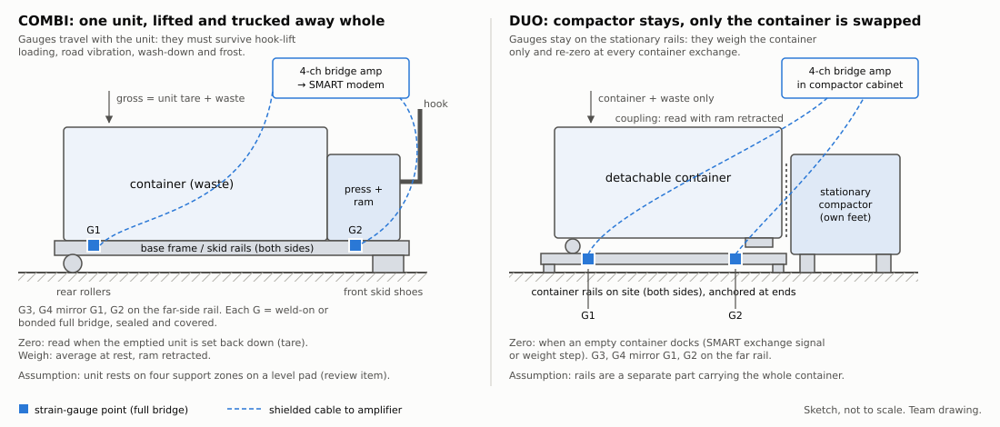
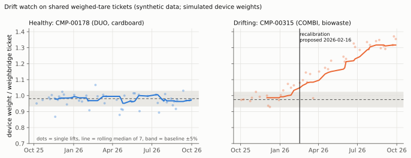
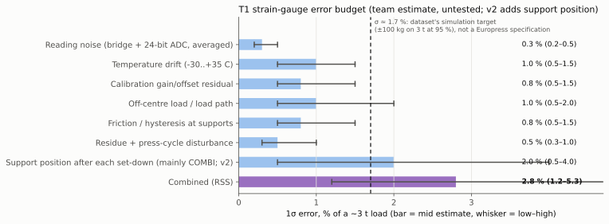
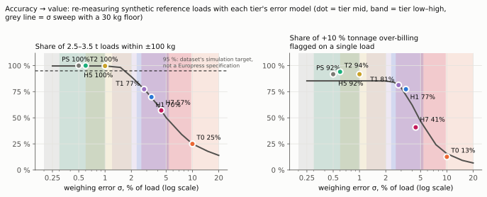

# FullLoad Part 1: weighing concept

**Getting an affordable, good-enough weight at the compactor.** Team FullLoad, Since AI Hackathon 2026, Europress
challenge, Part 1 ("Get the weight"). Draft, 7 Nov 2026. Everything in this document is **untested**. No hardware was
built or measured. The synthetic dataset cannot show that any weighing design works [1][2]. Every accuracy figure
carries a tag: *estimate* (team reasoning), *simulation target* (the starter kit's assumption) or *literature*
(a published vendor or reference value).

## 0. Summary

- **Chosen concept: T1, cheap strain gauges.** Four strain-gauge full bridges go on the load-carrying steel: the base
  frame on a COMBI, the stationary container rails on a DUO. A low-cost 24-bit bridge amplifier connects them to the
  existing SMART modem. Indicative hardware cost is **€100–480 per device** ([4][5][6][7] + team estimate), retrofit
  time **4–8 h**, and the expected 1σ error is **1.1–3.5 % of the load, mid 1.9 %** (*estimate*).
- **Alternatives.** **T0 virtual weight** uses the existing hydraulic pressure, ram position and fill level. It needs
  no new hardware (team estimate) and is a later software upgrade, but its error is about 5–20 % (*estimate*) and it
  is weak for biowaste. **T2 shear-beam load cells** give the best accuracy, about 0.3–1 % (*literature*), but cost
  about **€1,380–2,860 per device** ([8][9][10][11] + team estimate).
- **Business fit (PRODUCT.md §1).** The hardware is **free to the customer**. Europress funds it and earns it back
  from the operators' fee per verified tonne. Europress stays a technology company and never transports.
- **How the gauges stay honest.** They auto-zero after each lift. In service, each one is cross-checked against the
  weighbridge tickets that operators share: a rolling device-to-ticket ratio shows drift and proposes a
  recalibration, which a person approves (§6 step 3, Figure 4).
- **What the accuracy is worth.** We re-measured 5,787 synthetic reference loads with T1's mid error model. 91 % of
  2.5–3.5 t loads land within ±100 kg, and the median cost-per-tonne error is 1.7 % (§8). The ±100 kg on a 3 t load is **the
  dataset's simulation target, not a Europress specification** [2].

> **TOMMI (Q9):** The accuracy target is assumed. For forecasts and weight-triggered orders, we assume "ballpark but
> really close" [3] means a 1σ error of about 5 % or better. For a weight both sides could settle on, we use the
> ±100 kg on 3 t (1σ ≈ 1.7 %), the dataset's simulation target, not a Europress specification, as the working goal. If Tommi names a different figure, change the T1 design
> point and §9's acceptance threshold.

## 1. Requirement and accuracy reasoning

Today the weight that decides charges and credits is known only at the operator's weighbridge [1]. Europress wants a
weight **at the source** that is "cheap as possible" and "ballpark but really close", and customers "are not willing
to pay almost anything" for extra hardware [3]. So the design targets the lowest cost that still serves our use cases:

| Use of the device weight | Accuracy it needs (1σ, *estimate* from §8) | T0 | T1 | T2 |
|---|---|---|---|---|
| Fill → weight forecast, weight-triggered order | ≈ 5–10 % | yes (cardboard, plastics) | yes | yes |
| Cost-per-tonne transparency per site and month | ≈ 2–3 % | no | yes | yes |
| Checking a tonnage difference on **one** load (+10 % flagged) | ≈ 1–2 % | no | mostly (85 % flagged) | yes |
| Settlement basis for per-kg billing | ≈ 1–1.7 % **and** legal-for-trade approval [15] | no | not alone (§10) | closer |

Averaging helps a lot. Random error falls with the square root of the number of loads, so a 3 % systematic tonnage
difference shows up after about 2 loads at T1 mid and about 45 loads at T0 mid (*estimate*, `generated/accuracy_value.md`).
A systematic gain error does **not** average out. It is caught by the ticket cross-check in §6 step 3.

## 2. Measurement principle (T1)

The waste's weight bends the steel that carries it, and the bending stretches the steel surface by about 100–400 µm/m
(microstrain, µε). That is the strain level we assume at working stress in a frame member (*estimate*: 20–80 MPa
divided by E = 210 GPa). A foil strain gauge turns strain into a resistance change. Four gauges wired as a
**Wheatstone full bridge** at each point cancel most of the bending from other directions and most of the uniform
temperature change. With 5 V excitation, a full bridge at 200 µε gives about 1.3 mV (*estimate*: gauge factor 2,
Poisson arrangement). A 24-bit bridge ADC such as the ADS1232 has 17 nV RMS noise at 10 samples/s and gain 128 [7],
so **electrical noise is not the limit. Temperature and mechanics are** (§7).

- **Four measurement points** (G1–G4, Figure 1) sit near the four places where the load leaves the structure. The
  sum of the four bridges is proportional to the carried weight. The ratios between them show where the load sits
  (off-centre warning).
- **When to read:** only at rest. That means the ram is retracted, no press cycle for at least 60 s, and the reading
  is a 10–30 s average. SMART already knows the press state (operational_state, compaction cycles), so the firmware
  can gate the reading on it.
- **Net weight:** gross minus the **zero** taken after the last lift (auto-zero, §6 step 4). The device reports the net
  waste mass and its own 1σ, as the dataset's `mass_kg` and `mass_uncertainty_kg` fields already assume [2].
- **Gauge type:** weld-on (spot-welded carrier) or bonded foil gauges under a sealed cover. Weld-on carriers need no
  adhesive cure and are easier to fit in the field. HBK, for example, offers weldable foil gauges for −50 to +250 °C
  [14]. The cost range in §4 runs from hobby-grade foil gauges [5] to industrial ones [4]. **Which grade survives
  outdoor service is a human-review item.**

**Why T1 over T0 and T2.** T1 is the cheapest option that reaches about the dataset's simulation target at its mid
estimate. T0 costs nothing in hardware but misses the cost-per-tonne and verification uses by a factor of about 5. T2 meets
every use but costs 3–30× more hardware (and 2× the install time), which conflicts with "customers are not willing to
pay almost anything" [3] and with a free-to-customer rollout.

## 3. Placement

*Figure 1. T1 strain-gauge placement. Self-made sketch, not to scale. The mechanical assumptions are listed in §14.*

### 3.1 COMBI (compactor and container permanently joined, the whole unit is lifted and transported)

- **What is weighed:** the whole unit stands on its base frame, so the gauges carry compactor + container + waste.
  The fixed part (unit tare) drops out with the auto-zero taken when the **emptied unit is set back down** on site.
- **Where:** two points on each longitudinal base-frame (skid) rail, directly above the **rear rollers** and above
  the **front skid shoes**. These are the four zones through which the parked unit rests on its pad. The gauges go
  on the inner web of the rail, which the frame flanges protect from the hook-lift rails and from ground contact.
- **The sensor travels with the unit.** It must survive the hook-lift pull-up (the frame bends much more during
  lifting than when parked, so the gauge's strain range and fatigue life must cover that), road vibration, wash-down
  at the facility and Finnish frost. Cables run inside the frame to the unit's own electrics cabinet next to the
  SMART modem. There are no connectors to the truck.
- **Weigh only when parked:** readings taken during the lift or transport are discarded. The modem sees the
  transport as a power or communication gap, or as an abrupt load change, and resumes after it.
- **COMBI-specific risk:** if the skids rest on the pad along their whole length instead of on four zones, the load
  path depends on the pad's flatness. Then the unit needs **defined support pads** under the four zones (a small
  site-side steel part). This is human-review item 1.

### 3.2 DUO (compactor stays on site, only the detachable container is emptied)

- **What is weighed:** **only the container.** The gauges sit on the **stationary container rails** on which the
  container rests while it is docked. The compactor stands on its own feet, off the rails, so its weight and most of
  its vibration do not reach the gauges.
- **Where:** two points on each rail, near the rail's anchor or support points, where the rail carries the
  container's rollers and skid ends as a short beam. The gauges sit on the side or underside of the rail, away from
  the rolling path of the container rollers.
- **Container exchange:** the operator swaps a full container for an empty one, possibly a **different container
  with a different tare**. The system re-zeros when an empty container docks, detected from the weight step together
  with fill near zero and the SMART exchange or door signal. Each lift therefore reports *full weight before
  undocking minus empty weight after docking*, so a container's own tare never enters the result.
- **Press coupling:** while the ram pushes waste into the container, it also pushes the container against its stops.
  That force is not weight. Readings are therefore taken only with the ram retracted and settled (§2). Locking clamps
  that preload the container onto the rails would bias the reading, and are human-review item 3.
- The sensors never move, so DUO is mechanically the easier case. Lifting loads are irrelevant, and cables stay on
  the site installation.

## 4. Indicative bill of materials and cost per device

Currency conversions are a team assumption: 1 GBP = 1.15–1.20 EUR, 1 USD = 0.85–0.95 EUR, 1 SEK = 0.085–0.095 EUR.
Prices exclude VAT, are list prices for single units, and were accessed 6 Nov 2026. Volume prices will be lower.

**T1 strain gauges (chosen):**

| Item | Qty | Cost range (EUR) | Source |
|---|---|---|---|
| Foil strain gauges, 350 Ω, for 4 full bridges | 16 | €25–280 | [5] hobby grade, 10 for $18.40; [4] industrial grade, £60.29–72.87 per 5 |
| Bridge amplifier / 24-bit ADC board (HX711 class up to a production 4-channel ADS1232 class board with protection) | 1 | €5–40 | [6] HX711 board 45 SEK; [7] ADS1232 specs; production board team estimate |
| Gauge protection: coating, steel covers, surface-prep kit | 4 points | €30–80 | team estimate |
| Shielded cable 10–15 m, glands, small IP67 enclosure | 1 set | €30–60 | team estimate |
| Board temperature sensor, connector to the SMART modem | 1 | €5–20 | team estimate |
| **Total hardware T1** | | **≈ €100–480** | sum of the lines above ([4][5][6][7] + team estimate) |

**T2 shear-beam load cells (alternative):**

| Item | Qty | Cost range (EUR) | Source |
|---|---|---|---|
| Shear-beam load cell 5 t, C3, IP68 (combined error 0.017 %) | 4 | €1,000–1,740 | [8] €435 net each; low end is a team estimate for volume pricing |
| 4-channel summing / junction box, IP68 | 1 | €100–130 | [9] €130 net; low end team estimate |
| Weighing transmitter, RS485 / 4–20 mA | 1 | €50–330 | [10] €51.95 budget unit; [11] $350 branded 4-channel |
| Load-cell mounts, brackets, frame adaptation | 1 set | €200–600 | team estimate |
| Cable, enclosure | 1 set | €30–60 | team estimate |
| **Total hardware T2** | | **≈ €1,380–2,860** | sum of the lines above ([8][9][10][11] + team estimate) |

**T0 virtual weight:** €0 of new hardware (team estimate). It needs firmware and back-end work, plus pressure data at
a suitable sample rate (TOMMI, Q8).

**Labour:** at a technician rate of €60–90 per hour (team estimate), T1 installation costs about €240–720 and T2 about
€480–1,440 (team estimate, using the hours in §5). Fitting T1 in the factory on new units should take a fraction of
the retrofit time.

> **TOMMI (Q10):** We assume a hardware ceiling of **€500 per device** (team estimate until Tommi answers) and **one working day** of retrofit time. T1
> fits within both at its high end. T2 does not.
>
> **TOMMI (Q10b):** We assume **Europress funds the hardware** (free to the customer) and earns it back from the
> operators' per-tonne fees. It could also be bundled into a multi-year lease. The payback calculation belongs to the
> business case (PRODUCT.md §1), which takes these per-device costs as inputs.

## 5. Installation and retrofit

T1 has good retrofit potential. It needs no new structural parts in the base case, and the same kit serves new builds
(gauges fitted and calibrated at the end of the production line) and installed units. It does require a SMART modem
on the unit. Units without SMART need one, which is a sales opportunity because SMART is in only about 15 % of the
installed base [3].

**T1 retrofit steps (two technicians, 4–8 h, team estimate):**

1. **Check the unit (0.5 h).** Unit type, frame or rail drawing, gauge positions marked from an installation template
   per machine family.
2. **Prepare the surface (1–1.5 h).** Grind the paint off 4 small spots, then clean and degrease them.
3. **Fit the gauges (1–2 h).** Spot-weld the weldable gauge carriers, or bond the foil gauges with a fast-curing
   adhesive, then wire each full bridge.
4. **Protect (0.5–1 h).** Apply the sealant and coating, then bolt or clamp the steel cover plates on.
5. **Route the cables (0.5–1 h)** to the electrics cabinet. Mount the amplifier board and connect it to the SMART
   modem's serial or I²C port.
6. **Commission (0.5–1.5 h).** Take the zero, run the reference-weight calibration (§6 step 2), check the off-centre
   response by moving the reference weight, and send a test message to the back end.

**T2** additionally needs the unit lifted or the rails removed, load-cell mounts installed, and possibly frame
modification or welding. That takes 8–16 h (team estimate) and may need a structural review per machine family.
**T0** needs only a firmware or back-end update plus a calibration period, 0–1 h on site (team estimate).

## 6. Calibration

Cheap sensors are acceptable only because they are calibrated repeatedly. Calibration happens in four layers:

1. **Factory (new builds).** Each machine family gets a calibration of gain per bridge point on a test rig, with
   known weights at 4 positions. That gives the family's nominal gain and its sensitivity to off-centre loads. Each
   unit then gets a short end-of-line check.
2. **On-site reference weights (retrofit and after any repair).** Take a zero with the container empty. Then add one
   or two known loads, for example a 1,000 L IBC filled with water (about 1 t). Water is cheap and available on
   site, and the IBC can be moved to the front and rear zones to measure off-centre sensitivity. This step gives the
   unit's gain to about 0.5–1.5 % (*estimate*).
3. **In service: cross-check against shared weighbridge tickets.** Whenever an operator shares a **single-load,
   weighed-tare** ticket for a lift, the ratio device weight / ticket net is a free calibration point. Combined loads
   and stored-tare tickets are excluded because their nets are less reliable [2]. A rolling median of the last 7
   ratios is compared with the unit's baseline (the median of its first 10). If it stays outside ±5 % for two pairs
   in a row, the system **proposes** a recalibration. That proposal can be a gain correction factor (baseline /
   rolling median) or a service visit, and a person approves it. Figure 4 shows this on the synthetic data. Healthy
   device CMP-00178 (DUO, cardboard) stays inside the band all year. Drifting device CMP-00315 (COMBI, biowaste)
   moves from 0.975 to 1.317 and is flagged on 2026-02-16, after 16 ticket pairs. Of the 17 devices with at least
   30 usable pairs, 7 are flagged at least once (`generated/drift_watch.json`). The device weights in the dataset
   are simulated, so this demonstrates the method, not real sensor drift. Where an operator shares no tickets (in
   the synthetic data, one fictional operator shares none [2]), the fallback is an annual reference-weight check.
4. **Auto-zero after each lift.** The first stable reading after the unit returns empty (COMBI) or after an empty
   container docks (DUO) becomes the new zero. This removes slow offset drift, residue left in the container, and a
   different container's tare. A zero that differs from the last one by more than about 150 kg (*estimate*) is not
   accepted silently. It is flagged as possible residue, or as the wrong container type.

*Figure 4. In-service cross-check of device weight against shared, single-load, weighed-tare weighbridge tickets
(synthetic data, `scripts/drift_watch.py`).*

## 7. Error sources and error budget (T1)

The errors are combined by root-sum-square, which assumes the sources are independent. This is a team estimate based
on the physics in §2, and it is **untested**.

| Error source (1σ, % of a ~3 t load) | low | mid | high | Mitigation |
|---|---|---|---|---|
| Reading noise (bridge + 24-bit ADC, averaged) | 0.2 | 0.3 | 0.5 | average 10-30 s of samples at rest [7] |
| Temperature drift (-30..+35 C) | 0.5 | 1.0 | 1.5 | full bridges + board temperature model [14] |
| Calibration gain/offset residual | 0.5 | 0.8 | 1.5 | reference weights + ticket cross-check |
| Off-centre load / load path | 0.5 | 1.0 | 2.0 | 4 points, sum of bridges |
| Friction / hysteresis at supports | 0.5 | 0.8 | 1.5 | read after settling, ram retracted |
| Residue + press-cycle disturbance | 0.3 | 0.5 | 1.0 | auto-zero after each lift; read only at rest |
| **Combined (root-sum-square)** | **1.1** | **1.9** | **3.5** | estimate |

On top of the relative error there is an absolute floor of 20–50 kg (*estimate*), which dominates loads under about
0.5 t. The reasoning behind each line:

- **Temperature.** Thermal output is called potentially the most serious error source in static strain measurement
  [14]. Self-compensated gauges on steel, wired as full bridges, cancel uniform temperature changes. They do **not**
  cancel gradients, for example sun on one side of the frame or a cold morning after a warm day. With about
  200 µε of signal, a few µε of residual per 10 °C of gradient is about 0.5–1.5 %. Auto-zero helps only if the
  temperature at the zero is close to the temperature at the reading. A board temperature sensor plus a per-unit
  temperature coefficient, learned from the ticket pairs, reduces it further.
- **Off-centre load.** Waste is pushed in from one end and packs unevenly, and the four points do not see exactly the
  same gain. Summing four bridges and calibrating with the IBC at the front and the rear (§6 step 2) keeps this to about
  0.5–2 %.
- **Friction and hysteresis.** DUO containers sit on rollers and skids. COMBI skid shoes rest on a pad. Some load
  goes through friction and stays locked in. Reading after the ram has retracted and the structure has settled
  limits this.
- **Press cycle.** During compaction the ram force is far larger than the waste weight, so any reading taken then is
  invalid. It is gated out in firmware (§2).
- **Humidity is not a sensor error.** Wet cardboard **really is** heavier [3]. The device measures it correctly, but
  the weight that matters for pricing may differ from it (§10).

*Figure 2. T1 error budget (`scripts/tiers.py`). The dashed line is σ ≈ 1.7 %, i.e. ±100 kg on 3 t for 95 % of
readings: the dataset's simulation target, not a Europress specification [2].*

## 8. What the accuracy is worth (data-backed)

`scripts/accuracy_value.py` adapts the starter kit's `examples/weighing_accuracy_value.py` [16]. It takes 5,787 shared
single-load, weighed-tare weighbridge tickets from the synthetic competition dataset as reference masses (641 of them
in the 2.5–3.5 t band) and re-measures each one with every tier's error model, using a fixed seed:

| Tier (mid σ) | 2.5–3.5 t loads within ±100 kg | median cost-per-tonne error | +10 % over-billing flagged on one load | false alarms | loads to see a 3 % difference |
|---|---|---|---|---|---|
| T0 (10 %, 150 kg) | 25% | 8.6 % | 13% | 2.2 % | 45 |
| **T1 (1.9 %, 30 kg)** | **91%** | **1.7 %** | **85%** | **1.8 %** | **2** |
| T2 (0.6 %, 15 kg) | 100% | 0.7 % | 94% | 0.8 % | 1 |

The low and high variants of each tier are in `generated/accuracy_value.md`. T1 ranges from 99.5 % (low) to 68.8 %
(high) of loads within ±100 kg. For comparison, the dataset's own simulated device weights differ from the tickets by
a median of 2.1 % (p95 11.5 %), because faults, residue and stored tares add to the noise.

**Reading.** The T1 mid estimate is just short of the 95 % level of the dataset's simulation target, not a Europress specification. It is clearly good enough
for cost-per-tonne transparency, forecasts and weight-triggered orders, and for flagging larger tonnage differences on single
loads. These numbers re-use synthetic masses with an assumed error model. They show what an accuracy would be
**worth**, not that T1 reaches it.

*Figure 3. Accuracy → value (`scripts/accuracy_value.py`). The detection rate stays below 100 % even at small σ
because, on light loads, the absolute floor is larger than 10 % of the load.*

## 9. Validation experiment (plan, untested)

| Stage | What | Pass criterion (proposal) | Time / cost |
|---|---|---|---|
| A. Bench | One frame section or rail from each machine family, gauges fitted, loaded with known weights at 5 positions, in a climate chamber at −30, 0, +20 and +35 °C | Linearity and repeatability ≤ 0.5 %. Temperature effect after compensation ≤ 1 % over the range. Off-centre spread ≤ 1.5 % | 2–3 weeks, test-rig time (team estimate) |
| B. Field pilot | 10 COMBI + 10 DUO units across cardboard, mixed waste, biowaste and plastics, at sites whose operator shares weighbridge tickets. Every lift paired with a **single-load, weighed-tare** ticket | Over at least 30 pairs per unit, the 95th percentile of the absolute error ≤ 100 kg on 2.5–3.5 t loads (the dataset's simulation target, not a Europress specification; TOMMI Q9). Median bias ≤ 1 % after the on-site calibration | 3 months (team estimate) |
| C. 90-day drift watch | Run the §6 step 3 rolling ratio on every pilot unit. Log each proposed recalibration and its cause (gauge, residue, ticket error) | No unit more than 5 % off its baseline without being flagged. False recalibration proposals ≤ 1 per unit per quarter | runs during stage B |
| D. Durability | COMBI: count the hook-lift cycles and road kilometres. Check every gauge cover and seal at each service visit | No gauge failure in 3 months. Every failure gets a root cause | runs during stage B |

If stage B misses the threshold, the options are: better gauges or covers (higher BOM), T2 load cells for the
segments that need a settlement-grade weight, or T1 as a forecasting and transparency sensor only.

## 10. Limitations

- **Untested.** No hardware was built or measured. Every σ is an *estimate*, a *simulation target* or *literature*,
  and the dataset's device weights are simulated [1][2].
- **Biowaste (T0).** Biowaste gives almost no back-pressure, so the pressure fingerprint says little about its mass
  [3]. T0 is weak for biowaste. T1 and T2 do not depend on back-pressure.
- **Humidity and moisture change the real weight.** Wet cardboard is heavier, and its weight "can even change
  throughout the week" [3]. Every tier measures that water. A price on dry material needs a separate moisture
  correction or an agreement, and the T0 density model breaks when moisture changes.
- **Temperature drift.** Strain gauges are temperature-sensitive (§7). Outdoor units in Finland see −30 to +35 °C and
  sun on one side. Gradients are the largest single risk for T1.
- **Off-centre loads.** Uneven packing changes how the load spreads across the four points. Calibration reduces this
  but does not remove it.
- **The press cycle disturbs readings.** Ram forces are far larger than the waste weight, so readings are valid only
  at rest with the ram retracted. Frequent cycling at busy sites leaves fewer valid readings.
- **COMBI durability.** The gauges travel with the unit through lifting, road transport and wash-down. Their survival
  is a real risk and has not been examined.
- **Reference data depends on operators.** The in-service cross-check needs shared tickets. Some operators never
  share them [2].
- **Not legal for trade.** Using the device weight as a billing basis in the EU would need an approved
  non-automatic weighing instrument under Directive 2014/31/EU [15]. T1 is designed for transparency, forecasting and
  verification. Settlement on device weight needs agreement between the parties or certification work.
- **Small loads.** Below about 0.5 t the absolute floor of 20–50 kg dominates (*estimate*).

## 11. Comparison of the tiers

This table is generated by `scripts/tiers.py`. `sigma_tiers.json` carries the same values, and the app reads that
file.

| Tier | Name | σ rel % (low / mid / high) | σ abs kg floor (low / mid / high) | BOM EUR per device | Install h | Weak for | Evidence | Sources |
|---|---|---|---|---|---|---|---|---|
| T0 | Virtual weight (existing hydraulic pressure + fill) | 5.0 / 10.0 / 20.0 | 100 / 150 / 300 | €0 (no new hardware) team estimate (software only) | 0–1 | BIOWASTE, WET_CARDBOARD, MIXED_WASTE | estimate | [1] [3] [13] |
| T1 | Cheap strain gauges on frame / container rails | 1.1 / 1.9 / 3.5 | 20 / 30 / 50 | €100–480 [4][5][6][7] + team estimate | 4–8 | LOADS_UNDER_0.5T | estimate | [4] [5] [6] [7] [14] |
| T2 | Shear-beam load cells under the frame | 0.3 / 0.6 / 1.0 | 10 / 15 / 25 | €1,380–2,860 [8][9][10][11] + team estimate | 8–16 | – | literature | [8] [9] [10] [11] [12] [13] |

Notes on the table:

- **T0's σ** is a team estimate. Fill is known to about 5 % [3]. On top of that come the density variation of the
  material and moisture. The vehicle-side weighing in [13], which uses a hydraulic sensor on lift cylinders, shows
  that hydraulic signals can carry weight information. The compactor's back-pressure is a different and weaker
  signal.
- **T2's σ** draws on vendor claims of ≤ 1 % for chassis-mounted container-weighing systems [12][13] and on the C3
  cell class [8].
- **T1's σ** is the error budget in §7.

> **TOMMI (Q8):** T0 needs the pressure time series, meaning ram position and pressure over each cycle. We assume
> SMART can log them at ≥ 1 Hz, or at least the peak pressure per cycle. We have not seen any examples. T0 stays a
> future software upgrade until those examples are shared.

## 12. Brief coverage (QG1)

| Item in the challenge brief [1] (sections 02, 04, 07) | Section |
|---|---|
| Sensor / measurement principle | §2 (T1), §11 (T0, T2) |
| Placement | §3.1 COMBI, §3.2 DUO, Figure 1 |
| Indicative bill of materials and cost | §4 |
| Installation | §5 |
| Retrofit potential | §5 (first paragraph), §11 install hours |
| Calibration | §6 |
| Error sources | §7 |
| Accuracy reasoning / accuracy target | §1, §7, §8, Figures 2–3 |
| Limitations | §10 |
| Validation plan / experiment | §9 |
| Comparison of sensing options (load cells, strain, hydraulic) | §11 |
| Third-party sources and licences | `THIRD_PARTY_part1.md` |

## 13. How this feeds FullLoad

The app reads `sigma_tiers.json`. The accuracy slider moves σ between the tiers' low, mid and high values, and that
σ feeds the forecast uncertainty and the settlement uncertainty shown to the customer and the operator (PRODUCT.md
§7.5). The hardware cost range is an input to the payback in the business case. FullLoad is the product name.
Europress measures and verifies, and never transports.

## References

All web sources were accessed 6 Nov 2026. Prices exclude VAT unless stated otherwise. Some shops block automated
fetches, and for those the price comes from the shop's search listing, as marked below.

- [1] Europress Group Oy / Since AI: *SMART Material Value Engine — Weigh at Source, Create Value*, challenge brief,
  Since AI Hackathon 2026 (local file `resources/Europress_SinceAI_2026_Challenge_Brief_BUILDER_FINAL (1).pdf`).
- [2] Europress × Since AI starter kit v1.0.1: `docs/ASSUMPTIONS_AND_LIMITATIONS.md`, `configs/assumptions.yaml`
  (telemetry section), `docs/EUROPRESS_REVIEW.md` point 1.7, `docs/DATA_DICTIONARY.md` (local files, synthetic data).
- [3] Europress kickoff, Tommi Häkkinen, 6 Nov 2026. Whisper transcript `Röst 261106_182238.txt` (local file, imperfect
  transcription).
- [4] DigiKey UK, Micro-Measurements CEA-06-250UWA-350 linear strain gauge, 350 Ω, pack of 5, £60.29–72.87 per pack.
  https://www.digikey.co.uk/en/products/detail/micro-measurements-division-of-vishay-precision-group/CEA-06-250UWA-350/10414998
- [5] Newegg, 10 pcs BF350-3AA 350 Ω foil strain gauges, $18.40 (from the search listing; the page blocks automated
  fetch). https://www.newegg.com/p/1W7-00WA-035U7
- [6] Electrokit, HX711 24-bit ADC load-cell amplifier board, 45 SEK incl. 25 % VAT.
  https://www.electrokit.com/en/hx711-lastcellsforstarkare-monterad-pa-kort
- [7] Texas Instruments, ADS1232 24-bit ADC for bridge sensors, product page: 17 nV RMS at 10 SPS and gain 128,
  −40 to +105 °C. https://www.ti.com/product/ADS1232
- [8] KERN & SOHN shop, load cell CT 5000-3Q1: shear beam, 5 t, OIML C3 (combined error 0.017 %), IP68/IP69K, €435 net.
  https://kern-sohn.com/shop/en/products/measuring-technology-components/measuring-cells/CT-5000-3Q1
- [9] KERN & SOHN shop, junction box CJ X468: 4 channels, IP68, €130 net.
  https://kern-sohn.com/shop/en/products/measuring-technology-components/junction-boxes/CJ-X468
- [10] Fruugo IE, DIN-rail weighing transmitter with 4–20 mA and RS485, €51.95 (from the search listing; the page blocks
  automated fetch). https://www.fruugo.ie/din-rail-force-gauge-4-20ma-output-rs485-controller-high-precision-weighing-display-module-basic-style/p-460908759
- [11] WeighTech USA, Laumas TLB4 RS485 4-channel digital weight transmitter, $350 (from the search listing; the page
  blocks automated fetch). https://weightechusa.com/laumas-digital-weight-transmitter-tlb4-multi-channel
- [12] Hyva, "Vertical stabilizer and weighing system add to the power of Titan hookloaders": 4 load cells on the
  chassis, accuracy ≤ 1 % of measured weight (vendor claim).
  https://hyva.com/en/news/vertical-stabilizer-and-weighing-system-add-to-the-power-of-titan-hookloaders
- [13] Recycling Product News, "On-board weighing systems": the Vulcan roll-off scale uses shear-pin load cells and a
  hydraulic sensor on the lift cylinders, typically within 1 % of gross vehicle weight (vendor claim).
  https://www.recyclingproductnews.com/article/7414/on-board-weighing-systems
- [14] Micro-Measurements (VPG), Tech Note TN-504-1, *Strain Gage Thermal Output and Gage Factor Variation with
  Temperature* (third-party mirror https://docs.ampnuts.ru/eevblog.docs/VPG/tn504.pdf; index
  https://micro-measurements.com/knowledge-base/technical-notes). Weldable gauges: HBK LS31HT, −50 to +250 °C,
  https://www.hbkworld.com/en/products/transducers/strain/experimental-testing/special-applications/ls31
- [15] Directive 2014/31/EU on non-automatic weighing instruments. https://eur-lex.europa.eu/eli/dir/2014/31/oj
- [16] Starter kit v1.0.1, `examples/weighing_accuracy_value.py` (local file; adapted with attribution in
  `scripts/accuracy_value.py`).

## 14. Human-review list (QG11)

A person with machine knowledge must confirm these before the concept is shown as feasible:

1. A parked COMBI rests on **four defined support zones** (rear rollers + front skid shoes) on its pad. If the skids
   bear along their full length, the unit needs site support pads.
2. Gauge positions on the COMBI base-frame rail webs can be reached **without frame modification**, and stay clear of
   the hook-lift rollers and the truck's guide rails.
3. DUO containers rest on **separate stationary rails** that carry the whole container weight, and the docking
   clamps or locks do not preload the rails.
4. The DUO compactor stands on its own feet and does **not** load the container rails.
5. Strain at the gauge points is at least about **100 µε** under a full load (working stress ≥ about 20 MPa), so the
   signal is usable.
6. The peak strain at the COMBI gauge points during a **hook-lift pull-up and road transport** is within the gauge's
   strain range and fatigue life.
7. Weld-on gauge carriers (spot welding) are **allowed on the frame steel and coating** without harming the warranty
   or corrosion protection. If not, bonding is required.
8. The SMART modem has a free **serial or I²C port and power** for the amplifier board, and the firmware can gate
   readings on the ram state.
9. The **empty-container docking event** (DUO) and the **unit returned** event (COMBI) can be detected from existing
   SMART signals for the auto-zero.
10. Hobby-grade versus industrial gauges and covers: which grade survives **wash-down, frost and road salt** for the
    lease period.
