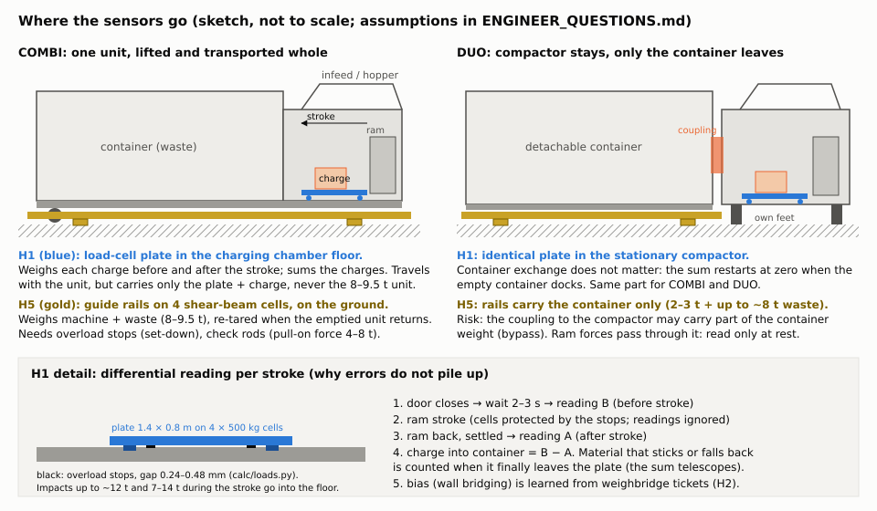
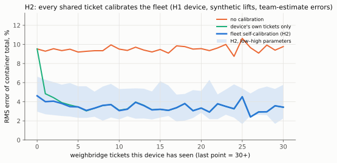
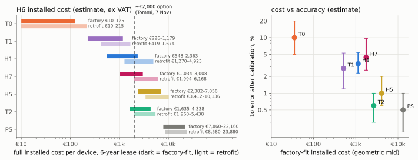
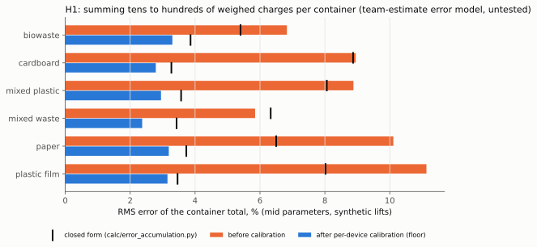

# OpenWeight Part 1: weighing concept (v2)

**How the compactor gets its own weight, cheaply enough to give away.** Team OpenWeight, Since AI Hackathon 2026,
Europress challenge, Part 1 ("Get the weight"). Version 2, 7 Nov 2026, after the follow-up talk with Tommi Häkkinen
[36]; H7 (hydraulic self-lift, §19) added the same evening. Everything in this document is **untested**. No
hardware was built or measured, and the team has no mechanical-engineering expertise: every mechanical number is an order-of-magnitude calculation in `part1/calc/`
for an engineer to check. The synthetic dataset cannot show that any weighing design works [1][2]. Every accuracy
figure carries a tag: *estimate* (team reasoning or a simulation with team-estimate inputs), *simulation target*
(the starter kit's assumption) or *literature* (a published vendor or reference value). Every number is traced in
`CLAIMS_LEDGER.md`; the failure modes we tried are in `RED_TEAM.md`; open questions for Europress are in
`ENGINEER_QUESTIONS.md`.

## 0. One page for Tommi

**The problem you named.** Without the weight "we always stop halfway" [36]. Platform scales under the unit exist
but are "almost as expensive" [36]; the weight has to come cheap, it "doesn't need to be very accurate", and an
option around €2,000 on a €20–25k COMBI is what customers would weigh it against [36].

**Our recommendation (changed 7 Nov evening): every new COMBI gets the H7 hydraulic self-lift, factory-fit.** A
two-end version (H7-2) is an option for higher accuracy. DUO containers have no hydraulics; for DUO the hopper
plate (H1) or weighing rails (H5) remain the options. Billing stays on the operator's certified weighbridge
(Directive 2014/31/EU [15]); the device weight is an estimate for planning, forecasts and cross-checks.

1. **How H7 works** (§19). The COMBI uses its own power pack to lift its door end about 10 mm. With the unit at
   rest, cylinder pressure × piston area gives that end's reaction R, and the waste is W = (R − R0)·L / x_w.
   Nothing sits in the charging chamber, and no sensor stays in the load path. It adds a cylinder, a valve section
   and a pressure sensor. Worked example: tare 27 bar, reading 57 bar, 2.5 t of waste (§19.2).
2. **Shared weighbridge tickets calibrate it** (H2, §4, §19.8). Bias in a cheap scale is stable per device, so
   every ticket an operator shares is a free calibration point, and a new unit starts from what its sister
   machines have learned. Accuracy on a 2.5 t pick-up: about **±10 % 1σ without tickets** and **±4.4 % 1σ after 10
   tickets** (range 2.6–9.7 %, *estimate*, untested, §19.5). Target ≤ 5 %. Lifting both ends (H7-2) gives 3.2 %
   at mid, at extra cost.
3. **Cost.** €1,034–3,008 factory-fit incl. 6 years' upkeep (team estimate, §19.7): capex €800–2,370 plus upkeep
   €39–106 a year. Retrofit is not recommended (€1,994–6,168). The business case plans with **€1,000 capex** per
   new unit (team decision) and €73 a year upkeep; at a €30 operator fee that just pays back (NPV +€0.18 M, year 9,
   `docs/PRICING.md`). Above about €1,020 it does not, so cost is the main risk and a supplier quote comes first.
4. **Good enough for what OpenWeight needs.** For forecasts, weight-triggered pickups and per-site tonnage, a few
   percent is plenty. Summed over a month of lifts, the per-site error drops further.
5. **What we are not sure about** (honest list): the centre of mass at partial fill, seal friction in winter, units
   standing on rails or plinths that eat the 10 mm stroke margin, a 31–57 kN point load on a rear frame not designed
   for it, sideways tipping, and CE work for a machine that lifts itself (§19.6). These decide the tests (§19.11).
6. **Alternatives we costed.** **H1 hopper-stage plate** (your idea, credited to Europress [36]): €548–2,363
   factory-fit, the same part fits COMBI and DUO, but the ram may slide over the plate and the overload gap is
   fragile (§3, §18). **H5 weighing guide rails**: ≈1 % (*estimate*) but €2,382–7,056 because of site work (§6, §7).
   **T0 virtual weight** (software on existing signals, §7): not part of the product claim; a roadmap item that
   could later estimate weights on older units. T1 strain gauges and the platform scale (€7,860–22,160) are in §10.
   The app interface uses **H7** as its chosen tier (`sigma_tiers.json`).

**Ask:** can a Europress engineer check the H7 frame, hydraulics and ground questions (11–14) in
`ENGINEER_QUESTIONS.md`, and host one self-lift test on a COMBI (§19.11)?

## 1. What changed in v2, and the requirement

| v1 (6 Nov) | v2 (7 Nov, after Tommi [36]) |
|---|---|
| Chosen concept T1 strain gauges on the frame | **H1 hopper-stage plate + H2 self-calibration**; T1 kept as an alternative with a revised (worse) error budget. Changed again 7 Nov evening: **H7 on every new COMBI** (§0, §19) |
| BOM only | **Full installed cost per device** (H6), retrofit and factory-fit, for every candidate |
| T0/T1/T2 | T0, T1, T2 plus **H1, H5 weighing rails, PS platform scale**; H7 hydraulic self-lift (team idea, §19) |
| Accuracy goal: ±100 kg on 3 t | Planning grade: "doesn't need to be very accurate, but it must be cheap" [36]; billing stays on the weighbridge |

Use of the device weight and the accuracy it needs (1σ, *estimate* from §8):

| Use | Accuracy needed | H1 + H2 |
|---|---|---|
| Fill → weight forecast, weight-triggered order | ≈ 5–10 % | yes |
| Per-site tonnage per month for per-kg tender pricing | ≈ 2–5 % | yes (the per-container part of the error averages out over a month of lifts) |
| Flag a +10 % difference on one load against the weighbridge | ≈ 1–3 % | mostly (77 % flagged at mid, §8) |
| Settlement | weighbridge only (Directive 2014/31/EU [15]) | not claimed |

> **TOMMI (Q9):** We assume planning grade means a 1σ of about 5 % or better on a container. If Europress needs
> the device to flag single-load differences reliably, H5 or a platform scale is the better fit (§10).

## 2. Mechanism first: the compactor's feed cycle

From public sources (marked) and our assumptions (marked *assumed*):

1. The user opens the infeed door and drops waste through the hopper. A Europress COMBI has an infeed aperture of
   1,500 × 900 mm at a loading height of 1,480 mm, a 25 t compaction force and a 42 s press cycle (listing [17]).
2. The waste lands in the **charging chamber** in front of the retracted ram, on the chamber floor or partly on the
   ram (Tommi [36]). *Assumed:* the chamber floor is about 0.4–0.6 m above ground, so a charge falls 0.9–1.1 m.
3. The door closes and the cycle starts; the ram pushes the charge into the container and retracts (*assumed*
   from the 42 s cycle [17]; Europress's exact stroke sequence and spill-back protection are ENGINEER_QUESTIONS Q2).
4. Each cycle adds one charge. The kit assumes a median charge of 8–30 kg depending on material [2]; in the
   synthetic data a container collects a median of 78 charges (compaction cycles) between lifts, 10–33 kg each
   (p10–p90), `generated/charge_sum.json`.
5. **COMBI:** the whole unit (machine 3 t per Tommi [36], 4.0–4.4 t in third-party listings of 20 m³ units [18])
   is pulled onto a hook-lift truck and emptied at the treatment site. **DUO:** the compactor stays; only the
   container is detached and exchanged. SMART already logs compaction cycles, fill and a press-load signal [2][3].

## 3. Alternative: H1 hopper-stage weighing + H2 self-calibration

*Status (7 Nov evening): H7 (§19) is the chosen concept for COMBI. H1 was the earlier recommendation and remains
an option for DUO, which has no hydraulics. The analysis below is kept as it was.*

*Figure 1. H1 plate and H5 rails on COMBI and DUO, and the H1 reading sequence. Self-made sketch, not to scale.*

### 3.1 Measurement principle

- **Weighing plate.** A wear-steel plate of about 1.4 × 0.8 m forms part of the charging-chamber floor where the
  charge lands. It rests on four 500 kg C3 load cells (2 t range, 0.017 % combined error [22]) whose signals are
  summed on a 24-bit weighing board connected to the SMART modem [6][10]. Overload stops under the plate limit the
  travel to about 0.24–0.48 mm (`calc/loads.py`), so impacts and compaction pressure go into the chamber floor.
- **Differential reading per stroke.** After the door closes, the firmware waits 2–3 s and takes reading B (before);
  after the ram has retracted and settled it takes reading A (after). The charge that entered the container is
  **B − A**. Material that sticks to the plate or springs back is simply counted when it finally leaves: the sum of
  all differences telescopes to the mass that crossed the plate. Several drops before one stroke are one charge.
- **Why the small range works.** A 9–30 kg charge is 0.4–1.5 % of the plate's range, which the cells resolve to
  about 0.3 kg (`calc/loads.py`). Temperature drift is negligible because B and A are about a minute apart (0.02–
  0.04 kg per charge, `calc/temperature.py`).
- **What it cannot see.** Waste that hangs on the hopper walls or rests on the ram when B is read is not on the plate
  but still goes into the container. This **bridging share** (team estimate: 1 % of a biowaste charge to 6 % of a
  cardboard charge, `calc/h1_params.py`) is the main error and is why H2 exists.
- **Container total.** The device reports the running sum since the last lift and its own 1σ, i.e. the dataset's
  `mass_kg` and `mass_uncertainty_kg` [2]. The sum resets when the emptied COMBI returns or an empty DUO container docks.

### 3.2 Firmware rules

1. Read only with the door closed, the ram retracted and the hydraulic pump idle, as a 2–3 s average.
2. Delay the automatic press start by 2–3 s so that reading B exists (TOMMI Q8: door-to-start timing).
3. Count every compaction cycle (SMART already does [2]). Ten strokes in a row with no weight change while the
   cycle counter runs = plate jammed or bridged: raise a fault. In the synthetic data that fires within 12–78 h
   depending on the material (`generated/fusion.md`).
4. Reject a difference above the plate's range or below −2 kg (team estimate) as an invalid pair.

## 4. Our edge: the fleet calibrates itself (H2)

**The idea.** Random errors of single charges average out over a container (√N), but the bridging share does not.
It is roughly constant for one device and one material, so it acts as a **gain error**. Every weighbridge ticket an
operator shares (single load, weighed tare) gives the ratio *device sum / ticket* for one container: a free
measurement of that gain. A Kalman filter per device tracks the gain (with a random walk for drift), and its
starting value is the average learned so far from **other devices of the same material and machine type**, so a
new device or a device whose operator shares nothing still starts from the fleet's knowledge (empirical Bayes).

**The measurement** (`scripts/self_calibration.py`, synthetic data, fixed seed). We replayed all 5,627 reference
lifts of 368 devices in time order. Each container was split into as many charges as the device ran compaction
cycles, each charge was weighed with the H1 error model (`calc/h1_params.py`, team estimates), and each device's
corrected weight was scored against the ticket **before** that ticket was used (one step ahead, out of sample):

| H1 container-total RMS error (low / mid / high) | no calibration | device's own tickets only | fleet self-calibration (H2) |
|---|---|---|---|
| before the device's first ticket (n = 0) | 6.8 / 9.5 / 13.8 % | 6.8 / 9.5 / 13.8 % | 3.0 / 4.6 / 6.6 % |
| after 1–3 tickets | 6.9 / 9.4 / 14.0 % | 2.9 / 4.4 / 6.7 % | 2.6 / 4.0 / 6.1 % |
| after 10 or more tickets | 6.9 / 9.6 / 14.3 % | 2.3 / 3.4 / 5.4 % | 2.3 / 3.4 / 5.4 % |

*Figure 2. RMS error of the container total vs the number of weighbridge tickets the device has seen (mid
parameters; band = H2 with low and high parameters).*

**What this shows, and what it does not.** With the stated assumptions, H2 halves the error of a brand-new device
(9.5 % → 4.6 % at mid) and reaches the floor of about 3.4 % after a few tickets; a device's own tickets alone need
1–3 tickets to catch up. In the synthetic data 78 devices belong to an operator that never shares tickets [2]: with
H2 they get the n = 0 figure instead of the raw 9.5 %. The analysis assumes that the bridging share is similar
within a material and machine type, that tickets arrive before the next lift, and that the synthetic ticket mass is
the truth. It measures the **method**, not the hardware.

**Who gets credit.** Weighing at the hopper is Europress's idea (Tommi, 7 Nov [36]). The differential
before/after reading, the fleet self-calibration and its analysis are the team's contribution. We make no novelty
claim beyond §11.

## 5. Placement and mechanics

### 5.1 COMBI (compactor and container joined; the whole unit is lifted and transported)

- **H1:** the plate sits in the floor of the unit's charging chamber. It **travels with the unit**, but it carries
  only its own mass and the charge: lifting and road loads on the plate are its own inertia (≈100–150 kg plate ×
  a few g, team estimate), well inside the stops. The cells see none of the 8–9.5 t unit load (`calc/loads.py`).
- **When the unit is tipped for emptying** at the treatment site, waste and liquid can run back into the chamber
  and over the plate (RED_TEAM R6). The seal and stops must survive that; the sum resets anyway when the unit
  returns, and the first stable reading becomes the plate's new zero.
- **Cabling** stays inside the unit to the existing electrics cabinet and SMART modem; no connector to the truck.

### 5.2 DUO (compactor stays on site; only the container is emptied)

- **H1:** the identical plate sits in the stationary compactor's charging chamber. Container exchange does not
  disturb it: the sum restarts at zero when the empty container docks (SMART exchange signal [2]); a different
  container's tare never enters the result, because the container is never weighed.
- The plate does not travel, so DUO is the easier case for H1. Sensors, part number and firmware are the same as on
  the COMBI (TOMMI: is the charging chamber the same design on both? ENGINEER_QUESTIONS Q2).

### 5.3 Loads the H1 plate must survive (`calc/loads.py`, order of magnitude)

#### H1: impact of a thrown charge on the weighing plate

Energy E = m(g·h + v0²/2), h = 0.9–1.1 m, v0 = 1.5 m/s; peak force of a linear spring F = 2E/d + mg. Plate range 4 × 500 kg = 2 t, safe limit 150% = 3 t.

| charge | kg | stop distance mm | peak force kN | × static weight | seen as t |
|---|---|---|---|---|---|
| plastic film bag, 9 kg (kit median charge) | 9 | 80 | 2.3–2.8 | 26–31× | 0.24–0.28 |
| cardboard charge, 18 kg (kit median) | 18 | 50 | 7.3–8.8 | 42–50× | 0.75–0.89 |
| biowaste bag, 30 kg (kit median) | 30 | 30 | 20.2–24.1 | 69–82× | 2.06–2.46 |
| dense item thrown hard, 25 kg (misuse) | 25 | 5 | 99.8–119.4 | 407–487× | 10.17–12.17 |

Worst case ≈ 12.2 t against a 3 t safe limit: **overload stops are required**; a cardboard charge (0.89 t) stays inside the cell range and a biowaste bag (2.5 t) inside the safe limit.

#### H1: vertical load on the plate during the compaction stroke

Ram pressure p = 25 t / 1.20 m² = 204 kPa; vertical floor pressure K·p with K = 0.3–0.6; plate 1.12 m² → **7–14 t** on the plate on every stroke, 3–7× the cell range. The stops carry this; the cells see only what the stop gap lets through. Readings are valid only with the ram retracted.

Stop gap: set at ~120 % of rated deflection, i.e. **0.24–0.48 mm** (cells deflect 0.2–0.4 mm at rated load [19]). A gap this small jams with grit or ice unless sealed (RED_TEAM R3). An elastomer layer would allow a few mm of travel but adds creep and hysteresis (team estimate).

Signal-to-range: a 9–30 kg charge is 0.4%–1.5% of the 2 t range. C3 cells have 0.017 % combined error [8][22] (≈0.3 kg on 2 t), so a charge reads to about ±1–3 % electrically; mechanics (bridging, friction) dominate (calc/error_accumulation.py).

## 6. Co-lead: H5 weighing guide rails (team idea)

**Principle.** Europress sells guide rails as an accessory (brief, unverified). Put two shear-beam load cells under
each rail so that the unit (COMBI) or the container (DUO) rests **only** on the rails. The weight is the sum of four
cells. The system zeros when the rails are empty, tares when the emptied unit or an empty container returns, and
reads before pick-up. The cells stay on the ground: no transport, no tipping.

- **COMBI:** the rails carry machine + waste, 8.0–9.5 t; a 1 t load is 18–25 % of the reading, and the machine tare
  is removed by re-taring (`calc/loads.py`).
- **DUO:** the rails carry the container only (2–3 t + up to ~8 t), *if* the coupling to the compactor does not
  carry part of its weight (load bypass, RED_TEAM R10).
- **Accuracy.** C3 cells are far better than needed [8][20]; temperature adds 0.3–0.7 % between tare and reading
  (`calc/temperature.py`); the installed error is set by mechanics: side restraint, friction, levelling, ice and
  debris. We estimate 0.6–2 % (mid 1 %, *estimate*), in line with vendor claims of ≤ 1 % for container weighing on
  hook-lift trucks [12][13].

#### H5: loads on the four rail cells

| case | total t | per cell, even t | heavier pair, per cell t | × dynamic 1.5 | cell rated / safe limit |
|---|---|---|---|---|---|
| COMBI full (machine + waste) | 8.0–9.5 | 2.0–2.4 | 2.2–3.3 | 3.3–5.0 | 5 t / 10 t |
| DUO full (container + waste) | 10.0–11.0 | 2.5–2.8 | 2.8–3.8 | 4.1–5.8 | 5 t / 10 t |

Pick-up of a full COMBI: when the hook lifts the front, the rear pair carries up to ~80% of 9.5 t → **5.7 t per rear cell** with the dynamic factor: inside a 5 t cell's 200 % safe limit [20] but with little margin. Overload stops under the rear pair give that margin; 10 t cells would too but double the zero drift (calc/temperature.py), so the design keeps 5 t cells + stops (team estimate).

#### H5: set-down impact of an empty COMBI (front half on the front pair of cells)

Peak force F = √(2E·k_eff) + mg, cell stiffness 1.6e+08 N/m each (0.3 mm at 5 t [19]).

| set-down speed m/s | rail stiffness N/m | energy J | peak per front cell t |
|---|---|---|---|
| 0.05 | 2.5e+07 | 3 | 1.7 |
| 0.05 | 5.0e+07 | 3 | 1.9 |
| 0.05 | rigid rail | 3 | 3.3 |
| 0.20 | 2.5e+07 | 45 | 3.5 |
| 0.20 | 5.0e+07 | 45 | 4.3 |
| 0.20 | rigid rail | 45 | 9.9 |

At the higher set-down speed on a stiff rail the peak reaches the 10 t safe limit of a 5 t cell (no margin for a faster or uneven drop): **overload stops (or 10 t cells plus a compliant pad) are required**; slow set-down on a flexible rail stays inside it.

#### H5: horizontal force when the hook-lift pulls the unit on or off

Rolling rollers μ ≈ 0.05 → 0.5 t; sliding steel skids μ = 0.4–0.8 [21] → **3.8–7.6 t horizontal** on a 9.5 t unit. Shear-beam cells must not carry this: longitudinal and lateral check rods (stay rods) anchored to the base take it, as in tank weighing modules with lift-off and side restraint [23].

Signal-to-range: on a COMBI the cells carry the machine too, so a 1 t load is 18%–25% of the reading; the machine tare is removed by re-taring when the emptied unit returns.

**Why H5 is cheaper than a platform scale, and why not by much.** A platform needs a deck or beams with ramps sized
for the whole unit plus a foundation (a 15 t container scale with beams and ramps lists at €4,800–5,620 before
installation [27]). H5 reuses the rails as the "deck" and adds only cells, stops and restraint, but it still needs a
level, anchored base and two technicians for a day or more. In our cost model H5 is about a third of the platform
scale and **above the ~€2,000 reference** even when the site is new (§7, team estimate).

## 7. Full installed cost per device (H6)

All lines per device, 6-year lease, ex VAT, labour at €55–90/h ([24] + team estimate), part prices cited, everything
else a team estimate (`calc/installed_cost.py`; line-by-line tables for every candidate in Appendix A):

| id | candidate | hardware (factory) | installed, retrofit | installed, factory-fit | factory-fit within ~€2,000? [36] | basis |
|---|---|---|---|---|---|---|
| T0 | Virtual weight from existing pressure + fill (v1) | €0–50 | €10–215 | €10–125 | yes | team estimate |
| T1 | Strain gauges on frame / container rails (v1 choice) | €95–480 | €419–1,674 | €226–1,179 | yes | [4][5][6][7][24] + team estimate |
| H1 | Hopper-stage weighing plate (idea: Europress / Tommi) | €270–1,430 | €1,270–4,923 | €548–2,363 | partly | [6][9][10][22][24][25] + team estimate |
| H7 | Hydraulic self-lift on the compactor's own power pack (idea: team) | €550–1,300 | €1,994–6,168 | €1,034–3,008 | partly | [24][39][48] + team estimate |
| H5 | Weighing guide rails (idea: team) | €1,310–3,100 | €3,412–10,136 | €2,382–7,056 | no | [8][9][10][11][23][24][26] + team estimate |
| T2 | Load cells under the unit's own frame (v1) | €1,160–2,600 | €1,960–5,438 | €1,635–4,338 | partly | [8][9][10][11][24][26] + team estimate |
| PS | Platform scale under the whole unit (Europress's existing option) | €4,800–12,000 | €8,580–23,880 | €7,860–22,160 | no | [24][27] + team estimate |

*Figure 3. Left: full installed cost per device (dark = factory-fit, light = retrofit) against the ~€2,000 reference
[36]. Right: factory-fit cost against the 1σ error after calibration (`scripts/cost_figure.py`).*

Reading the table:

- **H1 factory-fit (€548–2,363, team estimate)** is the only physical weighing option whose whole range is near the
  ~€2,000 reference [36]. Its largest lines are the cells (€100–880 for four, [22][25]) and development amortised
  over 2,000–5,000 units (€30–200 per unit, team estimate). With volume-priced cells the hardware is a few hundred euros.
- **H1 retrofit (€1,270–4,923, team estimate)** is expensive: the chamber floor must be cut and a sub-frame welded in.
  For the installed base, T0 (software, €10–215, team estimate) is the realistic first step.
- **The platform scale (€7,860–22,160 factory-fit, team estimate on [27])** matches Tommi's "almost as expensive"
  [36] if he meant the machine price: the scale itself is the smaller part; foundation, labour and calibration
  double it.
- **H7 factory-fit (€1,034–3,008, team estimate)** overlaps the reference. The parts alone (€550–1,300) match the
  team document [39]. Frame reinforcement, interlocks, a foot pad on soft ground and CE work push the total up
  (§19.7). COMBI only.
- Payback belongs to the business case (PRODUCT.md §1). `part1/installed_cost.json` carries every line for it.

> **TOMMI (Q10):** We assume Europress funds the hardware (free to the customer) and that a factory-fit option cost
> near €2,000 per unit [36] is acceptable when the per-tonne fees pay it back (team estimate). Tommi's own point: a customer who saves
> the €2,000 by choosing a unit without weighing makes the network less valuable [36].

## 8. Accuracy

### 8.1 Error accumulation over a container fill (H1)

Closed form (`calc/error_accumulation.py`) and Monte Carlo on the real synthetic lift sequence
(`scripts/charge_sum.py`, mid parameters):

| material | reference lifts | RMS error before calibration (sim / closed form) | floor after calibration (sim / closed form) |
|---|---|---|---|
| biowaste | 1206 | 6.8 % / 5.4 % | 3.3 % / 3.9 % |
| cardboard | 1864 | 8.9 % / 8.9 % | 2.8 % / 3.3 % |
| mixed_plastic | 172 | 8.9 % / 8.1 % | 3.0 % / 3.6 % |
| mixed_waste | 1470 | 5.8 % / 6.3 % | 2.4 % / 3.4 % |
| paper | 144 | 10.1 % / 6.5 % | 3.2 % / 3.7 % |
| plastic_film | 771 | 11.1 % / 8.0 % | 3.1 % / 3.5 % |
| **all (low / mid / high)** | 5627 | 6.3 / 8.2 / 13.3 % | 2.1 / 2.9 / 4.9 % |

*Figure 4. H1 container-total error per material, before calibration and after an ideal per-device correction.*

The random part shrinks with the number of charges and is about 1–4.5 % of the container. The bridging bias stays;
it is removed by calibration (§4). The floor after calibration, about 3 %, comes from how much the bridging share
changes from one container to the next (team estimate 2–5 %), and it is the number to measure in the pilot.

### 8.2 H1 error budget (per charge, 1σ, team estimate; `calc/h1_params.py`)

| Source | low / mid / high | Effect on the container total | Mitigation |
|---|---|---|---|
| Reading noise per reading | 0.3 / 0.5 / 1.0 kg | √N, ~5–15 kg per container | 2–3 s average at rest |
| Bridging share, mean per material | 1–6 % (by material), our guess off by 30–100 % | bias | H2 calibration |
| Bridging share, device to device | 2 / 3 / 5 % | bias per device | H2 calibration |
| Bridging share, charge to charge | 5 / 10 / 20 % of the charge | √N | averages out |
| Bridging share, container to container | 2 / 3 / 5 % | **floor after calibration** | none (measure in pilot) |
| Gain after test-weight commissioning | 0.5 / 1 / 2 % | bias | H2 calibration |
| Strokes without a valid reading pair | 0.5 / 1 / 3 % | bias + small random | firmware delay, H2 |
| Gain drift (debris, wear) | 0.3 / 0.5 / 1 % per month | slow bias | Kalman random walk, jam alarm |
| Temperature (B and A 1 min apart) | 0.02–0.04 kg per charge | negligible | differential reading |

The v1 T1 strain-gauge budget, now with the support-position line added by the red team (RED_TEAM R9):

| Error source (1σ, % of a ~3 t load) | low | mid | high | Mitigation |
|---|---|---|---|---|
| Reading noise (bridge + 24-bit ADC, averaged) | 0.2 | 0.3 | 0.5 | average 10-30 s of samples at rest [7] |
| Temperature drift (-30..+35 C) | 0.5 | 1.0 | 1.5 | full bridges + board temperature model [14] |
| Calibration gain/offset residual | 0.5 | 0.8 | 1.5 | reference weights + ticket cross-check |
| Off-centre load / load path | 0.5 | 1.0 | 2.0 | 4 points, sum of bridges |
| Friction / hysteresis at supports | 0.5 | 0.8 | 1.5 | read after settling, ram retracted |
| Residue + press-cycle disturbance | 0.3 | 0.5 | 1.0 | auto-zero after each lift; read only at rest |
| Support position after each set-down (mainly COMBI; v2) | 0.5 | 2.0 | 4.0 | frame strain measures bending, not reactions: ticket cross-check |
| **Combined (root-sum-square)** | **1.2** | **2.8** | **5.3** | estimate |

### 8.3 What the accuracy is worth (data-backed, v1 method)

`scripts/accuracy_value.py` re-measures 5,787 shared single-load, weighed-tare tickets with each tier's mid error
model [16]:

| Tier (mid σ) | 2.5–3.5 t loads within ±100 kg | median cost-per-tonne error | +10 % over-billing flagged on one load | false alarms | loads to see a 3 % difference |
|---|---|---|---|---|---|
| T0 (10 %, 150 kg) | 25% | 8.6 % | 13% | 2.2 % | 45 |
| T1 (2.8 %, 30 kg) | 77% | 2.1 % | 81% | 1.9 % | 4 |
| T2 (0.6 %, 15 kg) | 100% | 0.7 % | 94% | 0.8 % | 1 |
| **H1 (3.4 %, 10 kg)** | **70%** | **2.3 %** | **77%** | **1.8 %** | **6** |
| H7 (4.4 %, 80 kg) | 57% | 4.1 % | 41% | 2.1 % | 9 |
| H5 (1 %, 20 kg) | 100% | 1.0 % | 92% | 1.3 % | 1 |
| PS (0.5 %, 20 kg) | 100% | 0.8 % | 92% | 1.2 % | 1 |

The ±100 kg on a 3 t load is **the dataset's simulation target, not a Europress specification** [2]. H1 at mid
lands 70 % of 2.5–3.5 t loads within it, which is not settlement grade and is not meant to be.

## 9. Fusion with what the compactor already measures (H3)

`scripts/fusion.py` on the synthetic data:

| Signal | What it gives (synthetic data) |
|---|---|
| T0: fill × volume × learned density (fill only) | median abs error 5.8 %, robust σ 8.6 %, p90 20.0 %, but RMS 89.5 % (heavy outliers) over 3741 lifts |
| T0 + press load index | median abs error 7.7 % vs 5.7 % fill-only on the same 1835 lifts (second half of the year) |
| H1 + H2 fused with T0 (inverse variance) | RMS 3.38 % → 3.25 % (weight on H1 0.881, T0 used on 94% of lifts after an agreement gate) |
| Compaction-cycle counter → plate-jam alarm (10 strokes with no weight change) | biowaste 25.3 h, cardboard 12.0 h, mixed plastic 29.3 h, mixed waste 22.1 h, paper 78.4 h, plastic film 29.5 h |

- **T0 alone** (fill × volume × learned density) is surprisingly good on the median in the synthetic world (5.8 %)
  but has heavy outliers (fill faults, residue, biowaste), so it is a fallback, not a primary weight. The kit's
  press-load index made it worse, not better; real pressure curves were not available (TOMMI Q8).
- **Fused with H1 + H2**, T0 adds little (3.38 % → 3.25 % RMS) because H1 is already much better. Its value is
  **redundancy**: when the plate is faulted, T0 keeps the weight flowing at T0 accuracy, and a large H1–T0
  disagreement is itself a fault signal.
- **The cycle counter is the most useful existing signal**: it tells H1 how many charges it should have weighed, so
  a jammed or bridged plate is found within about a day (12–78 h by material).

## 10. Comparison of the candidates (H4)

Interface values (`sigma_tiers.json`, generated by `scripts/tiers.py`; σ after calibration, BOM = factory-fit
hardware lines of §7):

| Tier | Name | σ rel % (low / mid / high) | σ abs kg floor (low / mid / high) | BOM EUR per device | Install h | Weak for | Evidence | Sources |
|---|---|---|---|---|---|---|---|---|
| T0 | Virtual weight (existing hydraulic pressure + fill) | 5.0 / 10.0 / 20.0 | 100 / 150 / 300 | €0–50 team estimate (software only) | 0–1 | BIOWASTE, WET_CARDBOARD, MIXED_WASTE | estimate | [1] [3] [13] |
| T1 | Cheap strain gauges on frame / container rails | 1.2 / 2.8 / 5.3 | 20 / 30 / 50 | €100–480 [4][5][6][7] + team estimate | 4–8 | LOADS_UNDER_0.5T, COMBI_SUPPORT_CHANGES | estimate | [4] [5] [6] [7] [14] |
| T2 | Shear-beam load cells under the frame | 0.3 / 0.6 / 1.0 | 10 / 15 / 25 | €1,160–2,600 [8][9][10][11][26] + team estimate | 8–16 | – | literature | [8] [9] [10] [11] [12] [13] [26] |
| H1 | Hopper-stage weighing plate + fleet self-calibration (hopper idea: Europress) | 2.3 / 3.4 / 5.4 | 5 / 10 / 20 | €270–1,430 [6][9][10][22][25] + team estimate | 10–20 | RETROFIT_UNITS, BIOWASTE_LIQUIDS, NEW_DEVICE_BEFORE_TICKETS | estimate | [22] [25] [28] [29] [36] |
| H7 | Hydraulic self-lift on the compactor's own power pack (team idea, to explore) | 2.6 / 4.4 / 9.7 | 40 / 80 / 200 | €550–1,300 [39] + team estimate | 12–24 | DUO, RETROFIT_UNITS, RAILS_AND_PLINTHS, SOFT_GROUND, NEW_DEVICE_BEFORE_TICKETS, SNOW_ON_ROOF | estimate | [39] [40] [42] [43] [48] |
| H5 | Weighing guide rails (team idea) | 0.6 / 1.0 / 2.0 | 10 / 20 / 40 | €1,310–3,100 [8][9][10][11][23][26] + team estimate | 12–24 | SITES_WITHOUT_RAILS, ICE_AND_DEBRIS | estimate | [8] [12] [13] [20] [26] [27] |
| PS | Platform scale under the whole unit (Europress's existing option) | 0.2 / 0.5 / 1.0 | 10 / 20 / 40 | €4,800–12,000 [27] + team estimate | 16–32 | COST | estimate | [27] [36] |

| | T0 virtual | T1 strain gauges | H1 hopper plate + H2 | **H7 self-lift + H2 (chosen)** | H5 weighing rails | T2 cells in frame | PS platform scale |
|---|---|---|---|---|---|---|---|
| Installed, factory-fit (§7, team estimate) | €10–125 | €226–1,179 | **€548–2,363** | €1,034–3,008 | €2,382–7,056 | €1,635–4,338 | €7,860–22,160 |
| 1σ after calibration (*estimate*) | 5–20 % | 1.2–5.3 % | **2.3–5.4 %** | 2.6–9.7 % (one end), 1.7–8.4 % (both ends) | 0.6–2 % | 0.3–1 % | 0.2–1 % |
| COMBI | yes | gauges travel, frame bending changes per set-down | **yes, isolated from unit load** | yes (new units), lifts its own door end | yes, ground side, 8–9.5 t range | cells travel with the unit | yes |
| DUO | yes | yes (stationary rails) | **yes, same part** | no hydraulics on a DUO container; H1 or H5 for DUO (§19.3) | yes, coupling bypass risk | per container, impractical | yes |
| Retrofit | remote | 4–8 h on site | hard (floor cut) | hard (frame, valve block) | site work | hard | site work |
| Durability risk | none | gauges in the main load path | stops, seal, liquids | seals, foot, ground, rod in transport | ice, debris, set-down | transport shocks | low |
| Main weakness | outliers, biowaste | support changes on COMBI | bridging bias (needs H2) | centre of mass, ground, CE | cost, site work | cost, transport | cost |

**Why H1 was the earlier choice** (superseded 7 Nov evening: H7 on every new COMBI, §0 and §19; H1 stays an option
for DUO).
- Against **PS** (the prior attempt [36]) and **H5**: both weigh the whole unit or container, so they need heavy
  cells, restraint and site work, and they cost more than the ~€2,000 reference [36] in our model (team estimate, §7); they are far more
  accurate than planning needs. H5 is the right choice where a site needs near-settlement accuracy (§14 fallbacks).
- Against **T1**: T1 is cheaper, but on a COMBI frame strain measures bending, which depends on where the unit
  stands after each set-down, and the gauges carry the full lifting loads [36]; H1 answers Tommi's "where would the
  sensor be?" by taking the sensor out of that load path. If the bench test (§14) fails, T1 on DUO rails is the
  fallback.
- Against **H7** (team idea, §19): H7 keeps every sensor out of the charging chamber and out of the load path. That
  avoids H1's two doubtful points. But it costs more, fits only COMBI, and depends on a centre-of-mass model, on
  the ground and on CE work. On 7 Nov evening the team chose H7 for every new COMBI: it is factory-fit, keeps the
  sensor out of the chamber, and shared tickets calibrate it. H1 stays an option for DUO.
- Against **T0**: T0 needs no hardware, but it is weak for biowaste [3] and has heavy outliers (§9). It is a
  roadmap item that could later estimate weights on older units, not part of the product claim.

## 11. Prior art (WG5) and what is new

Search on 7 Nov 2026 (Google Patents, vendor sites; not a freedom-to-operate search):

| # | Prior art | What it does | How ours differs |
|---|---|---|---|
| [28] | US 6,427,585 B1 / US 6,138,557 (Marathon Equipment, priority 1999, expired) | Transfer-station compactor on load cells; records the weight increase after each addition of waste before compaction and keeps a running total | Same per-charge running-total idea, but the whole apparatus is weighed. H1 weighs only a plate in the charging zone, so the cells are 10–20× smaller |
| [29] | US 2023/0219317 A1 (vertical refuse baler) | Floating bed on a load cell under the compaction chamber floor, mechanical stop to protect the cell | Very close to the H1 plate hardware (floating floor + stop). Ours is in a horizontal container compactor and reads before/after each stroke. **FTO check needed** |
| [30] | US 11,148,383 B2 (BACE, active) | Retrofit shear-beam load cells under a baler frame, weighs material independently of the press force, tags each bale | Weighs the whole machine; H1 weighs the charge |
| [31] | US 12,379,240 B1 (Canalytics, active, granted 2025) | Hydraulic piston scales on the ground under the casters of a detachable compactor container; rails only guide | Close to **H5 on a DUO**. H5 puts cells under the rails; **FTO check needed before H5** |
| [32] | US 4,729,304 (refuse compactor and transfer chamber) | Weight sensors under the chamber stop charging at a set weight | Whole-chamber weighing, transfer stations |
| [27] | WEDI container scale (product) | 15 t weighing beams with ramps on 4 × 5 t cells for roll-off containers | Same physics as H5; H5 integrates it into Europress's guide rails |
| [35] | Avermann MPC press containers (product) | "Weighing system for exact cost calculation" offered as an option | Construction not published; shows the market exists |
| [12][13][38] | Hyva hook-loader weighing, Vulcan roll-off scale, Pfreundt roll-off scale (products) | Weigh the container on the truck, ≤ 1 % claimed | Truck-side, owned by the operator; OpenWeight needs the weight at the source |
| [33][34] | Enviroweigh bin-lift weighing; EP2544968B1 bin with load cells per deposit | Weigh each bin or deposit (pay-as-you-throw) | Per-deposit weighing exists for bins; H1 does it inside a compactor |
| [40][41] | US 5,285,020; US 5,064,008 / US 5,065,828 (refuse-vehicle lift weighing) | Pressure transducers on the truck's lift cylinders weigh the lifted bin; a bypass valve gives a static reading | **Same physics as H7** (cylinder pressure → weight); the truck lifts a bin, not a compactor itself |
| [42] | US 2020/0096383 A1 and US 11,320,299 B2 (Cargotec / Hiab, hooklift) | Weight, and in the second patent the centre of mass, of a demountable platform from the hooklift main-cylinder force over the lift | Very close to H7's physics **and** its centre-of-mass problem, but truck-side and owned by the operator. H7 weighs at the site, before any truck comes |
| [43] | US 7,795,547; RAVAS hydraulic forklift scales | Pressure in the lift cylinder while moving up and down; averaging cancels friction hysteresis | **H7's up/down averaging is not new** |
| [44] | DE 4405000 A1 (Woelfle, 1994) | Stops a hydraulic lift and averages piston- and rod-side pressure over the oscillation to cancel friction | Friction cancellation by averaging is known |
| [45][46][47] | US 2016/0202111 A1 (hydraulic lifting units weigh a shipping container); aircraft jack load gauges; US 5,117,373 (fluid-bladder load cell under a container) | Lift-to-weigh with hydraulic jacks; jack gauges are "approximate only" because of seal friction [46] | Lifting a box on hydraulic jacks to weigh it is old; the jacks are separate equipment, not the machine's own power pack |

**Novelty (WG6).** Weighing each charge and keeping a running total is **not new** [28]; a floating floor on load
cells with a stop is **not new** [29]. The hopper-stage direction for Europress's compactors is Europress's own
idea [36]. What we did not find in this limited search is the combination of a charging-zone plate read before and
after each stroke **with** fleet-level self-calibration from shared weighbridge tickets; we did not search the
calibration side in depth, so we claim **no novelty**, only a product combination worth an FTO search.

**H7 (team idea).** Weighing from cylinder pressure is **not new**: refuse trucks [40][41], hooklifts [42] and
forklifts [43] all do it. Averaging up and down to cancel friction is **not new** either [43][44], and nor is
lifting a container on hydraulic jacks to weigh it [45]. Hiab even estimates the centre of mass of a hooklift
body [42]. What we did **not** find, in a limited search on 7 Nov (Google Patents, vendor pages, no FTO), is
a **stationary compactor that lifts itself with its own ram power pack, at its own site, to weigh its contents**.
Nor did we find that weight used as a reference reading to train a fleet-wide virtual scale, with the centre-of-
mass bias calibrated from shared weighbridge tickets. That is the part we present as new and worth exploring,
**not** as a novelty claim. Hiab [42] is the closest document and needs an FTO read before productisation.

## 12. Installation and retrofit

**H1 factory-fit (2–4 h on the line, team estimate):** fit the plate sub-frame when the chamber floor is welded,
mount cells, stops, side stays and seal, wire the weighing board to the SMART modem, end-of-line check with four
25 kg test weights at two positions (0.5–1 h).

**H1 retrofit (10–20 h, team estimate):** COMBI to a workshop (hook-lift round trip, operator's truck), DUO on site;
cut the floor opening, weld the sub-frame, fit plate and cells, wire, commission with test weights. Needs a
structural check of the chamber floor per machine family (ENGINEER_QUESTIONS Q1).

**H5 (retrofit 12–24 h, team estimate):** level and anchor two rail bases, fit cells, stops and check rods, run the
cable to the unit, calibrate with a known load. On a new site the base is built anyway (6–12 h extra).

**T0:** firmware and back-end update; calibration comes from tickets (H2).

## 13. Calibration

1. **Factory / end of line (H1):** test weights on the plate set the cell gain (residual 0.5–2 %, team estimate).
2. **Every stroke (H1):** the differential reading is its own zero; drift between strokes is negligible.
3. **Every lift:** the sum resets when the emptied COMBI returns or an empty DUO container docks; H5 re-tares.
4. **Every shared ticket (H2):** updates the device's gain; a new device starts from its sister machines (§4).
5. **Drift watch (v1 method):** a rolling device/ticket ratio outside ±5 % proposes a recalibration for a person to
   approve (`scripts/drift_watch.py`, `figures/drift_watch.svg`); the cycle-count jam alarm catches hard faults (§3.2).
6. **No tickets:** devices whose operator never shares get the fleet prior plus an annual test-weight check.

## 14. Validation experiment (plan, untested)

| Stage | What | Pass criterion (proposal) | Time |
|---|---|---|---|
| A. Bench, plate | One charging chamber with the plate, on a rig. Drop tests (9–30 kg bags, 25 kg dense item, 1.1 m), 10,000 ram cycles, grit, ice and leachate in the gap | No cell damage; zero shift < 0.5 kg after 10,000 cycles; differential error < 0.5 kg per charge | 3–4 weeks (team estimate) |
| B. Bench, bridging | Real cardboard, film, mixed and bio charges, weighed separately, then through the chamber | Bridging share per material measured (replaces our 1–6 % guess) | 1–2 weeks |
| C. Field pilot | 10 COMBI + 10 DUO, operators that share tickets, every lift paired with a single-load weighed-tare ticket | After 10 tickets, 1σ of the container total ≤ 5 % per device (planning grade, TOMMI Q9); H2 n = 0 error ≤ 6 % on held-out devices | 3 months |
| D. Durability | Count strokes, COMBI tipping cycles and jam alarms | No plate seizure that the cycle-count alarm does not catch within 24 h | during C |

If stage A fails, fall back to T1 on DUO rails and T0 on COMBI; if C misses only on cardboard, accept a higher σ
there or use H5 at cardboard-heavy sites.

## 15. Limitations

- **Untested.** No hardware was built or measured; every σ and euro is an *estimate*, a *simulation target* or
  *literature*; the dataset's masses are synthetic [1][2]; the team has no mechanical-engineering expertise.
- **Bridging and partial charges (H1).** The share of a charge carried by the walls or the ram is our guess (1–6 %).
  Its container-to-container variation sets the floor after calibration.
- **Biowaste.** For H1: liquids in the plate gap, corrosion and sticking (RED_TEAM R4); for T0: little
  back-pressure, so the pressure fingerprint says little [3].
- **Humidity and moisture change the real weight.** Wet cardboard is heavier and its weight changes during the week
  [3]; every weighing option measures that water, and the weighbridge does too.
- **Temperature drift.** Negligible for H1 (differential), 0.3–0.7 % for H5, large for T1 strain gauges (§8.2);
  below −10 °C the cells' datasheet gives no figure [20].
- **Off-centre loads.** H1: a charge landing half on the ram is partly unweighed (bridging share). H5/PS: summing
  four cells handles it. T1: off-centre load and support position change the reading.
- **The press cycle disturbs readings.** Ram and floor forces are hundreds of times the charge; readings are valid
  only with the ram retracted and settled, and the press start must wait 2–3 s.
- **Overloads.** Misuse impacts up to ~12 t and 7–14 t on every stroke depend on overload stops with a sub-millimetre
  gap that grit or ice can block (RED_TEAM R3).
- **Tickets.** H2 needs shared tickets; some operators share none [2]. Ticket errors and lags are not modelled.
- **Retrofit.** H1 is a factory-fit design; retrofit costs €1,270–4,923 (team estimate).
- **Not legal for trade** [15]. Billing stays on the operator's weighbridge (PRODUCT.md §1).
- **H7 (§19)**: centre of mass at partial fill, seal friction in winter, ground (rails, plinths, soft ground eat
  the 10 mm stroke margin), a point load on the rear frame, snow on the roof changing the tare, and CE work for an
  automatic self-lift. COMBI only; retrofit €1,994–6,168 (team estimate).
- **Freedom to operate** is not checked ([29][31]; for H7 [42]).

## 16. Brief coverage (QG1)

| Item in the challenge brief [1] and the v2 brief | Section |
|---|---|
| Sensor / measurement principle | §3.1 (H1), §6 (H5), §10 (others) |
| Placement | §5.1 COMBI, §5.2 DUO, §6, Figure 1 |
| Indicative bill of materials and cost | §7, Appendix A |
| Installation | §12 |
| Retrofit potential | §7, §12 |
| Calibration | §13, §4 |
| Error sources | §8.2, §15 |
| Accuracy reasoning / accuracy target | §1, §8, Figures 2–4 |
| Limitations | §15 |
| Validation plan / experiment | §14 |
| Comparison of sensing options | §10, Figure 3 |
| v2: our edge (H1 + H2), prior art, pitch summary | §4, §11, §0 |
| H7 hydraulic self-lift: principle, statics, placement, procedure, errors, safety, cost, prior art | §19, §11, Appendix A |
| Third-party sources and licences | `THIRD_PARTY_part1.md` |

## 17. How this feeds OpenWeight

The app reads `sigma_tiers.json` (same shape as v1; seven tiers incl. H7; `chosen_tier` = H7). The accuracy slider moves σ
between a tier's low, mid and high values. `installed_cost.json` gives the business case the full installed cost per
device, retrofit and factory-fit; `pipeline/fullload/pricing.py` splits it into capex and upkeep. Screen 2 shows
the H7 worked example (§19.2), its installed cost and its accuracy. Europress measures, and never transports; OpenWeight is the product name.

## References

Web sources accessed 6–7 Nov 2026; prices ex VAT unless stated. Some pages block automated fetches; for those the
figure comes from the search listing, as marked.

- [1] Europress Group Oy / Since AI: *SMART Material Value Engine — Weigh at Source, Create Value*, challenge brief
  (local file `resources/Europress_SinceAI_2026_Challenge_Brief_BUILDER_FINAL (1).pdf`).
- [2] Europress × Since AI starter kit v1.0.1: `docs/ASSUMPTIONS_AND_LIMITATIONS.md`, `configs/assumptions.yaml`,
  `docs/EUROPRESS_REVIEW.md` point 1.7, `docs/DATA_DICTIONARY.md` (local files, synthetic data).
- [3] Europress kickoff, Tommi Häkkinen, 6 Nov 2026. Whisper transcript `Röst 261106_182238.txt` (local, imperfect).
- [4] DigiKey UK, Micro-Measurements CEA-06-250UWA-350 strain gauge, £60.29–72.87 per 5.
  https://www.digikey.co.uk/en/products/detail/micro-measurements-division-of-vishay-precision-group/CEA-06-250UWA-350/10414998
- [5] Newegg, 10 pcs BF350-3AA foil strain gauges, $18.40 (search listing). https://www.newegg.com/p/1W7-00WA-035U7
- [6] Electrokit, HX711 load-cell amplifier board, 45 SEK incl. VAT.
  https://www.electrokit.com/en/hx711-lastcellsforstarkare-monterad-pa-kort
- [7] Texas Instruments ADS1232 24-bit bridge ADC. https://www.ti.com/product/ADS1232
- [8] KERN & SOHN, load cell CT 5000-3Q1, 5 t shear beam, C3 (0.017 %), IP68, €435 net.
  https://kern-sohn.com/shop/en/products/measuring-technology-components/measuring-cells/CT-5000-3Q1
- [9] KERN & SOHN, junction box CJ X468, 4 channels, IP68, €130 net.
  https://kern-sohn.com/shop/en/products/measuring-technology-components/junction-boxes/CJ-X468
- [10] Fruugo IE, DIN-rail weighing transmitter 4–20 mA / RS485, €51.95 (search listing).
  https://www.fruugo.ie/din-rail-force-gauge-4-20ma-output-rs485-controller-high-precision-weighing-display-module-basic-style/p-460908759
- [11] WeighTech USA, Laumas TLB4 4-channel transmitter, $350 (search listing).
  https://weightechusa.com/laumas-digital-weight-transmitter-tlb4-multi-channel
- [12] Hyva, Titan hookloader weighing system, ≤ 1 % (vendor claim).
  https://hyva.com/en/news/vertical-stabilizer-and-weighing-system-add-to-the-power-of-titan-hookloaders
- [13] Recycling Product News, "On-board weighing systems" (Vulcan roll-off scale, ~1 %, vendor claim).
  https://www.recyclingproductnews.com/article/7414/on-board-weighing-systems
- [14] Micro-Measurements Tech Note TN-504-1 (mirror https://docs.ampnuts.ru/eevblog.docs/VPG/tn504.pdf); HBK LS31HT
  weldable gauges https://www.hbkworld.com/en/products/transducers/strain/experimental-testing/special-applications/ls31
- [15] Directive 2014/31/EU on non-automatic weighing instruments. https://eur-lex.europa.eu/eli/dir/2014/31/oj
- [16] Starter kit v1.0.1 `examples/weighing_accuracy_value.py` (adapted with attribution in `scripts/accuracy_value.py`).
- [17] machinetools.com, Europress COMBI model page: infeed 1,500 × 900 mm, infeed height 1,480 mm, compaction force
  25 t, press cycle 42 s (search listing).
  https://www.machinetools.com/en/models/europress-combi
- [18] Third-party listings of used 20 m³ Europress units: "Combio 20", 4,010 kg (https://www.finn.no/434718104);
  CMAX 20 m³, 4,435 kg empty (https://www.werktuigen.com/europress-cmax/wt-181-00081) (search listings).
- [19] Shear-beam deflection at rated load: Applied Measurement SBR 0.2–0.4 mm (https://appliedmeasurement.com.au/product/sbr/);
  Lahti Precision BC5 < 0.4 mm (https://lahtiprecision.fi-p.seravo.com/wp-content/uploads/2019/08/Lahti_Precision_Load-Cell_BC5_EN.pdf)
  (search listings).
- [20] Flintec SSB5 datasheet: safe load 200 %, ultimate 300 %, TC0 0.04 %/10 °C, TC span 0.02 %/10 °C, compensated
  −10…+40 °C, IP68. https://res.cloudinary.com/flintec/image/upload/v1778856507/strapiDev/ssb5_datasheet_en_44120d30ad.pdf
- [21] Engineering ToolBox, friction coefficients (steel on steel dry 0.5–0.8 static, 0.42 kinetic).
  https://www.engineeringtoolbox.com/friction-coefficients-d_778.html
- [22] KERN & SOHN, load cell CT 500-3Q1, 500 kg, C3, IP68/IP69K, €220 net.
  https://kern-sohn.com/shop/en/products/measuring-technology-components/measuring-cells/CT-500-3Q1
- [23] Central Carolina Scale, weigh module catalog: 5,000 kg module with lift-off / tip-over protection, $1,225
  (search listing). https://www.centralcarolinascale.com/Weigh-Module-Catalog.pdf
- [24] City of Turku, contract rates for additional work 2024: fitter €55/h ex VAT (search listing).
  https://ah.turku.fi/kh/2024/1028025p/Images/2337276.pdf
- [25] IndiaMART, ADI Controls ASP-631 single-point load cell, IP67, ₹1,200 (search listing).
  https://m.indiamart.com/proddetail/adi-controls-asp-631-single-point-platform-load-cell-2854775790591.html
- [26] San Diego Scale, Zemic BM8H 10 klb stainless shear-beam load cell, IP68, $262.50.
  https://sandiegoscale.com/products/zemic-bm8h-10klb-stainless-steel-shear-beam-load-cell-oiml-approved
- [27] Werktuigen.com, WEDI container scale for roll-off containers: 15 t, 4 × 5 t cells, weighing beams and ramps,
  €4,800 (description: €5,620) + VAT, new. https://www.werktuigen.com/firma+wedi+gmbh-containerwaage/wt-591-0742
- [28] US 6,427,585 B1, Marathon Equipment, *Method and apparatus for measuring the length of a waste log and/or weight
  of waste log…* (continuation of US 6,138,557). https://patents.google.com/patent/US6427585B1/en
- [29] US 2023/0219317 A1, vertical refuse baler with floating bed on a load cell and mechanical stop.
  https://ipiq.io/patents/386072
- [30] US 11,148,383 B2, BACE LLC, *Weight-measurement retrofitting for recyclable-waste balers*.
  https://patents.google.com/patent/US11148383B2/en
- [31] US 12,379,240 B1, Canalytics Technologies, *Method and apparatus for measuring the weight of a container using
  load cells*. https://patents.google.com/patent/US12379240B1/en
- [32] US 4,729,304, *Refuse compactor and transfer chamber* (search listing).
  https://image-ppubs.uspto.gov/dirsearch-public/print/downloadPdf/4729304
- [33] Transport Engineer, "Weigh for pay" (Enviroweigh bin-lift weighing, search listing).
  https://www.transportengineer.org.uk/content/features/weigh-for-pay
- [34] EP2544968B1, *Bin for collecting solid waste* (load cells per deposit, search listing).
  https://patents.google.com/patent/EP2544968B1/it
- [35] Avermann MPC 10 P/E press container brochure, weighing system option (search listing).
  https://machines.interzero.at/files/products/avermann/MPC%2010%20P_E.pdf
- [36] Europress follow-up talk, Tommi Häkkinen, 7 Nov 2026. Whisper transcript `Since.AI.2.txt` (local, Finnish,
  noisy): hopper-stage idea, ~3 t machine and ~5 t waste, platform scales "almost as expensive", basic COMBI
  €20–25k, ~€2,000 option reference.
- [37] OptiCare Expert service price list: maintenance on site €152/h ex VAT (search listing; upper bound only).
  https://www.optiscangroup.com/wp-content/uploads/2024/03/OptiCare-Expert-Palveluhinnasto.pdf
- [38] Pfreundt roll-off dumper scale catalogue (search listing).
  https://pdf.directindustry.com/pdf/pfreundt-gmbh/roll-off-dumper-scale/91271-656882.html
- [39] Team document *Plus-malli: kestävä versio – yhteenveto* (Mike, 7 Nov 2026, 4-page PDF, Finnish; local file)
  and its independent review `reviews/PLUS_MALLI_REVIEW.md`. Source of the H7 idea, geometry (cylinder 0.5–1 m from
  the rear, 10 mm lift, 50 mm stroke, foot 30 mm above runner bottom, 300 × 300 mm ball-joint foot), the 15 s
  lift/lower procedure, the durability measures and the parts estimate €400–800 + €150–300.
- [40] US 5,285,020 A, *Control system for weighing of load in hydraulically operated lift assembly* (refuse truck).
  https://patents.google.com/patent/US5285020A/en
- [41] US 5,064,008 A and US 5,065,828 A, *Hydraulic control system for weighing* (refuse vehicle lift; search listing).
  https://patents.google.com/patent/US5064008
- [42] US 2020/0096383 A1, Cargotec Patenter AB / Hiab AB, *Method and System for Determining the Weight of a
  Demountable Platform* (priority 20 Sep 2018; hooklift main-cylinder force). https://patents.google.com/patent/US20200096383A1/en ;
  related US 11,320,299 B2 (Hiab AB, mass **and centre of mass** of a demountable platform; named on the [42] page,
  not opened). https://patents.google.com/patent/US11320299B2/en
- [43] US 7,795,547, *Method of weight determination of a load carried by a lifter of a lifting device* (up/down
  movement against friction hysteresis; search listing) https://patents.google.com/patent/US7795547 ; RAVAS hydraulic
  forklift scale, weighing up and down (search listing) https://www.logisticsbusiness.com/?p=17766
- [44] DE 4405000 A1, Woelfle GmbH, *Weighing of load being lifted by hydraulic cylinder* (filed 1994, withdrawn).
  https://patents.google.com/patent/DE4405000A1/en
- [45] US 2016/0202111 A1, *Container lift and/or weighing system* (search listing).
  https://patents.google.com/patent/US20160202111A1/en
- [46] Malabar, "Is the jack load gauge necessary for an aircraft jack?" (gauge is approximate; seal friction; search
  listing). https://malabar.com/faq/is-the-jack-load-gauge-necessary-for-an-aircraft-jack
- [47] US 5,117,373 A, *Low profile weight measuring system for containers* (fluid-bladder load cell).
  https://patents.google.com/patent/US5117373A/en
- [48] Regulation (EU) 2023/1230 on machinery (applies from 20 Jan 2027; replaces Directive 2006/42/EC).
  https://eur-lex.europa.eu/eli/reg/2023/1230/oj
- [49] Team sheet *Duo: lift each end once, solve for weight and centre of gravity* (7 Nov 2026, 1 page; local file
  `duo_mechanism.pdf`) and its technical appendix `weighing_appendix.py` / `.pdf` (Monte Carlo, seed 42).
  Reviews: `reviews/DUO_MECHANISM_REVIEW.md`, `reviews/WEIGHING_APPENDIX_REVIEW.md` (the appendix reproduces; the sheet
  quotes 99.9 % / 95.6 % where the appendix gives 99.8 % / 94.0 %).

## Appendix A. Installed cost, line by line (`generated/calc_installed_cost.md`)

### T0: Virtual weight from existing pressure + fill (v1)

| H6 line | what | retrofit | factory-fit | source |
|---|---|---|---|---|
| sensors | none (existing pressure, ram position, fill) | €0–0 | €0–0 | [3] existing sensors |
| electronics | none, or a faster pressure log | €0–50 | €0–50 | team estimate |
| mechanical | none | €0–0 | €0–0 | team estimate (none needed) |
| site work | none | €0–0 | €0–0 | team estimate (none needed) |
| labour | remote firmware update; 0–1 h on site | €0–90 | €0–0 | team estimate × rate [24] |
| calibration | learned from shared weighbridge tickets (H2) | €0–0 | €0–0 | scripts/self_calibration.py |
| maintenance (6 y) | none beyond software | €0–0 | €0–0 | team estimate |
| development (NRE) | model, firmware, back end: €50–150k | €10–75 | €10–75 | team estimate |
| **total** |  | **€10–215** | **€10–125** | sum of lines |

### T1: Strain gauges on frame / container rails (v1 choice)

| H6 line | what | retrofit | factory-fit | source |
|---|---|---|---|---|
| sensors | 16 foil gauges for 4 full bridges | €25–280 | €25–280 | [4][5] |
| electronics | 24-bit bridge board, temperature sensor, connector | €10–60 | €10–60 | [6][7] + team estimate |
| mechanical | gauge covers, coating, cable, glands, enclosure | €60–140 | €60–140 | team estimate (v1 §4) |
| site work | none | €0–0 | €0–0 | team estimate (none needed) |
| labour | retrofit 4–8 h; factory 1–3 h | €220–720 | €55–270 | v1 §5 hours × rate [24] |
| calibration | water IBC (~1 t) at two positions, 1–1.5 h | €55–135 | €28–90 | v1 §6 × rate [24] |
| maintenance (6 y) | 30–60 % chance of re-gauging one point (2–4 h + parts) | €39–264 | €39–264 | team estimate |
| development (NRE) | gauge layout per family, test rig, firmware: €50–150k | €10–75 | €10–75 | team estimate |
| **total** |  | **€419–1,674** | **€226–1,179** | sum of lines |

### H1: Hopper-stage weighing plate (idea: Europress / Tommi)

| H6 line | what | retrofit | factory-fit | source |
|---|---|---|---|---|
| sensors | 4 × 500 kg C3 IP68 cells under the plate | €100–880 | €100–880 | [22] €220 each list; low end [25] ≈€12 per cell + team estimate for volume C3 |
| electronics | 4-channel 24-bit ADC / weighing board on the SMART modem, junction | €25–180 | €20–150 | [6] HX711 board, [10] €51.95 transmitter, [9] €130 junction box; team estimate |
| mechanical | plate 1.4 × 0.8 m wear steel, cell mounts, overload stops, side stays, perimeter seal | €400–1,000 | €150–400 | team estimate (retrofit: cut the chamber floor and weld a sub-frame) |
| site work | none on site; COMBI retrofit: hook-lift round trip to a workshop | €0–400 | €0–0 | team estimate |
| labour | retrofit 10–20 h (cut, weld, fit, wire); factory 2–4 h on the line | €550–1,800 | €110–360 | hours team estimate × rate [24] |
| calibration | test weights (4 × 25 kg) on the plate, firmware set-up | €55–180 | €28–90 | team estimate × rate [24] |
| maintenance (6 y) | clean the seal gap at each service (0.25 h/yr), new seal, 30–40 % chance of one cell | €110–283 | €110–283 | team estimate |
| development (NRE) | plate design per machine family, firmware gating, field test: €150–400k | €30–200 | €30–200 | team estimate |
| **total** |  | **€1,270–4,923** | **€548–2,363** | sum of lines |

### H7: Hydraulic self-lift on the compactor's own power pack (idea: team)

| H6 line | what | retrofit | factory-fit | source |
|---|---|---|---|---|
| sensors | 0–250 bar pressure transducer, rod position switch, oil temperature | €60–200 | €60–200 | team estimate (no supplier quote yet; [39] lists the sensor inside its €400–800 base system) |
| electronics | valve coil driver + inputs on the SMART modem, motion sensor, door / hook interlock | €50–200 | €40–150 | team estimate |
| mechanical | 80 mm single-acting cylinder with spring return, ball-joint 300 mm foot, steel housing, bellows, scraper; valve section (solenoid, pressure-compensated throttle, load-holding, relief), steel pipe, shear pin; local frame reinforcement | €800–1,800 | €450–950 | [39] parts €550–1,100 (retail −50 %, team estimate) + team estimate for reinforcement; retrofit: cut and weld the rear frame, extend the valve block |
| site work | steel or concrete pad under the foot on gravel / hot asphalt sites; COMBI retrofit: hook-lift round trip to a workshop | €0–550 | €0–150 | team estimate (calc/h7_hydraulic.py ground table) |
| labour | retrofit 12–24 h (frame, hydraulics, wiring); factory 3–6 h on the line | €660–2,160 | €165–540 | hours team estimate × rate [24] |
| calibration | tare lift, known load (water IBCs) at two positions to fix L / x, firmware set-up | €160–420 | €55–180 | team estimate × rate [24] |
| maintenance (6 y) | bellows, foot and seal check 0.5 h/yr; 30–60 % chance of a seal kit (€80–300 + 2 h); 20–40 % chance of a new pressure sensor | €234–638 | €234–638 | team estimate |
| development (NRE) | frame FEA per family, hydraulic circuit, machinery risk assessment and CE file update [48], firmware, field test: €150–400k | €30–200 | €30–200 | team estimate |
| **total** |  | **€1,994–6,168** | **€1,034–3,008** | sum of lines |

### H5: Weighing guide rails (idea: team)

| H6 line | what | retrofit | factory-fit | source |
|---|---|---|---|---|
| sensors | 4 × 5 t shear-beam C3 IP68 cells | €900–1,740 | €900–1,740 | [26] Zemic BM8H $262.50 ≈ €225–250; [8] KERN CT 5000 €435 |
| electronics | IP68 summing box + weighing transmitter to the SMART modem | €110–460 | €110–460 | [9] €130 box (low: board-level summing, team estimate), [10] €51.95–[11] $350 transmitter |
| mechanical | rail modification and cell seats, overload stops, lift-off and side restraint (check rods) | €500–1,400 | €300–900 | team estimate; [23] a 5 t weigh module with lift-off/tip protection lists $1,225 |
| site work | level and anchor two rail bases (concrete pads), cable conduit to the unit | €800–2,500 | €300–1,000 | team estimate (factory-fit = new site where the base is being built anyway) |
| labour | retrofit 12–24 h (2 technicians); new installation 6–12 h extra | €660–2,160 | €330–1,080 | hours team estimate × rate [24] |
| calibration | known load on the rails (water IBCs or hired test weights), commissioning | €150–800 | €150–800 | team estimate |
| maintenance (6 y) | clean under the rails, ice and debris checks 0.5–1 h/yr; 30–60 % chance of one cell; cable repair | €282–1,001 | €282–1,001 | team estimate |
| development (NRE) | rail design, restraint, firmware: €50–150k | €10–75 | €10–75 | team estimate |
| **total** |  | **€3,412–10,136** | **€2,382–7,056** | sum of lines |

### T2: Load cells under the unit's own frame (v1)

| H6 line | what | retrofit | factory-fit | source |
|---|---|---|---|---|
| sensors | 4 × 5 t shear-beam C3 cells | €900–1,740 | €900–1,740 | [26][8] |
| electronics | summing box + transmitter | €110–460 | €110–460 | [9][10][11] |
| mechanical | cell mounts in the frame, frame adaptation, stops | €200–600 | €150–400 | team estimate (v1 §4) |
| site work | none (cells travel with a COMBI) | €0–0 | €0–0 | team estimate (none needed) |
| labour | retrofit 8–16 h; factory 3–6 h | €440–1,440 | €165–540 | v1 §5 hours × rate [24] |
| calibration | known load, commissioning | €150–500 | €150–500 | team estimate |
| maintenance (6 y) | cells travel with a COMBI: 40–80 % chance of one cell, cable | €140–548 | €140–548 | team estimate |
| development (NRE) | frame redesign per family, structural review: €100–300k | €20–150 | €20–150 | team estimate |
| **total** |  | **€1,960–5,438** | **€1,635–4,338** | sum of lines |

### PS: Platform scale under the whole unit (Europress's existing option)

| H6 line | what | retrofit | factory-fit | source |
|---|---|---|---|---|
| sensors | 4–6 heavy cells (included in the platform price) | €0–0 | €0–0 | [27] (in the platform price) |
| electronics | indicator / transmitter (included) | €0–0 | €0–0 | [27] (in the platform price) |
| mechanical | steel weighing platform or beams with ramps, ~15 t | €4,800–12,000 | €4,800–12,000 | [27] container scale €4,800–5,620 (beams + ramps, 15 t); full deck high end team estimate |
| site work | foundation or pit, ramps, anchoring, drainage | €2,000–6,000 | €1,500–5,000 | team estimate |
| labour | 16–32 h retrofit; 12–24 h new site | €880–2,880 | €660–2,160 | team estimate × rate [24] |
| calibration | test weights by a scale service | €400–1,500 | €400–1,500 | team estimate |
| maintenance (6 y) | annual check, cleaning, one cell | €500–1,500 | €500–1,500 | team estimate |
| development (NRE) | exists today | €0–0 | €0–0 | [36] |
| **total** |  | **€8,580–23,880** | **€7,860–22,160** | sum of lines |

## 18. Human-review list (QG11)

A person with machine knowledge must confirm these before the concept is shown as feasible (the same questions,
phrased for Discord, are in `ENGINEER_QUESTIONS.md`):

1. A 1.4 × 0.8 m section of the **charging-chamber floor** can be a separate plate on load cells without weakening
   the chamber, on COMBI and DUO alike.
2. The **ram rides on side guides or wear strips**, not on the floor area where the plate would sit.
3. Overload stops with a **0.24–0.48 mm gap** can carry 7–14 t of floor pressure every stroke and misuse impacts up
   to ~12 t, and a seal can keep grit, ice and leachate out of the gap.
4. The automatic press start can wait **2–3 s** after the door closes so the plate can be read.
5. Our guess of the **bridging share** (1 % biowaste to 6 % cardboard of a charge hanging on walls or ram) is
   plausible for Europress hoppers.
6. Liquids that run back into the chamber when a COMBI is **tipped for emptying** do not flood the plate's cells.
7. The SMART modem has a free port and power for a 4-channel weighing board, and logs **door and cycle events**.
8. For H5: guide rails can carry the **whole** weight of a COMBI (8–9.5 t) or a DUO container, and a DUO coupling
   does not carry part of the container's weight.
9. For H5: the hook-lift **set-down speed** and the horizontal pull force (our 3.8–7.6 t on dry skids) are in the
   right range.
10. Why the existing **platform scales** are expensive, so that our cost model for PS and H5 can be checked.

### Review of this list (lead developer with Claude, 7 Nov; no mechanical-engineering expertise on the team)

| # | Verdict | Reasoning |
|---|---|---|
| 1 | Plausible, needs Europress | A floor insert is a common way to weigh in a hopper, but stiffness of the chamber around a cut-out is a structural question only Europress can answer. |
| 2 | **Doubtful** | In many compactors the ram slides on the chamber floor or on wear strips set into it. If so, the plate sits in the ram's path and must survive the ram scraping over it every stroke. This is the biggest open risk for H1. |
| 3 | **Doubtful** | A sub-millimetre stop gap in a waste chamber (grit, ice, leachate) is fragile. A wider gap needs stiffer cells and loses resolution. Second biggest risk. |
| 4 | Likely | A short delay before the press start is a firmware change. |
| 5 | Unknown, order of magnitude plausible | Only a bench test (§14 B) settles it. |
| 6 | Needs Europress | COMBI tipping drains the chamber; the cells need drainage and IP68 sealing. |
| 7 | Needs Europress | Engineer question 10. |
| 8 | Unknown | Decides whether H5 is cheap; engineer question 8. |
| 9 | Plausible order of magnitude | From the load calculations in `calc/loads.py`. |
| 10 | Partly answered | Tommi: existing scale platforms are "almost as expensive"; the team document names Scaletipper X1 as expensive and limited to bin-fed sites. |

Consequence: H1 has two doubtful mechanical points (2, 3). It stays an option credited to Europress (now for DUO),
and the hydraulic self-lift (H7, §19) became the chosen concept for every new COMBI on 7 Nov evening.

## 19. H7: hydraulic self-lift (team idea)

**Status: the chosen concept for every new COMBI (untested).** H7 comes from the team document [39] (Mike, 7 Nov). It was
reviewed independently (`reviews/PLUS_MALLI_REVIEW.md`), and every number below comes from `calc/h7_hydraulic.py`
or `calc/installed_cost.py` (team estimates, untested). We kept the PDF's idea and procedure. Where its assumptions
did not hold, we changed or flagged them (§19.9). Prior art is in §11.

### 19.1 Principle

A COMBI already carries a hydraulic power pack to drive its ram. H7 adds four things:

- one single-acting cylinder in a steel housing in the rear frame, 0.5–1 m forward of the door end [39];
- a valve section with a pressure-compensated throttle;
- a load-holding valve and a relief valve;
- one pressure sensor.

On a trigger, the cylinder pushes a ball-jointed foot onto the ground and lifts the door end about 10 mm. The front
of the runners stays on the ground and acts as the pivot. With the unit at rest, **cylinder pressure × piston area
= the door-end reaction R**. The unit now stands on three supports: the two runner fronts and the foot. The cylinder
force therefore depends only on the moment about the pivot line, and the waste's sideways position does not matter
(review row 2). No sensor carries load except during the ~30 s of a reading. The idea is new to us because of
*what* lifts *what*: the compactor lifts itself, at the site, with the hydraulics it already has.

### 19.2 Statics, with the working shown (`calc/h7_hydraulic.py`)

Take moments about the front pivot. M is the machine mass, W the waste mass, x the lever arm from the pivot and L
the distance from the pivot to the cylinder:

- loaded unit: R·L = M·x_m + W·x_w
- empty unit, measured when it returns: R0·L = M·x_m
- subtract: **W = (R − R0)·L / x_w** [39]

This holds only if L and both x are measured from the same pivot (review row 1). The result is linear in L/x_w:
a 1 % error in the waste's centre of mass gives a 1 % error in W.

Inputs:

- machine 3.0–4.5 t and waste up to 5 t, from `calc/loads.py` [18][36];
- **door-end share of the machine 0.30–0.45**: this is 1 minus the press-end share used for H5 in `calc/loads.py`;
- waste centre of mass x_w/L = 0.45–0.75 (team estimate);
- L = 5.0–6.0 m (team estimate).

The press is assumed to sit at the hook end and the door at the other end. The PDF moves the cylinder away from the
door end to avoid emptying impacts [39], which fits that assumption (ENGINEER_QUESTIONS 14).

| case | cylinder force kN | pressure bar, 63 mm bore | pressure bar, 80 mm bore |
|---|---|---|---|
| empty unit (tare R0) | 9–20 | 28–64 | 18–40 |
| full, 5 t waste (R) | 31–57 | 99–182 | 61–113 |

**Design choice: 80 mm bore.** It needs at most 113 bar in the heaviest case, against the ~200 bar system pressure
Tommi named [36]. A 63 mm bore would need 182 bar, too close to that limit. A relief valve set just above the design
force means an over-heavy unit simply does not lift, which is itself a reading ("above design load").

**Worked example** (mid values: M = 3.75 t, door-end share 0.375, W = 2.5 t, x_w/L = 0.6, 80 mm bore = 50.3 cm²):

- tare: R0 = 3.75 × 0.375 = 1.41 t = 13.8 kN → **27 bar**
- loaded: R = 1.41 + 2.5 × 0.6 = 2.91 t = 28.5 kN → **57 bar**
- result: W = (2.91 − 1.41) / 0.6 = 2.5 t

One bar on this cylinder is 0.50 kN, or about **85 kg of waste**. So the sensor's repeatability matters more than
its range.

**Flow and energy.** A 10 mm lift moves 50 cm³ of oil. Over 15 s that is 0.20 L/min, far below the power pack's
flow, so a pressure-compensated throttle sets the speed (0.67 mm/s). The mechanical work is 0.6 kJ per lift,
which is negligible. What costs energy is starting the pump, which matters on SMARTSolar units (review row 13).

**Stroke budget.** Stroke 50 mm − 30 mm to reach the ground − 10 mm lift = **10 mm** left for uneven ground, soft
ground or rails [39]. That margin is thin (§19.6).

### 19.3 Where it sits: COMBI, DUO, retrofit

- **COMBI (new units: the target).** The cylinder sits in the rear frame between the runners, 0.5–1 m forward of
  the door end, out of the way of door impacts during emptying [39]. Steel pipe inside the frame runs to the power
  pack, and the sensor sits in the press-unit cabinet [39]. The cylinder lifts the door end, so the heavy press
  section stays mostly on the pivot. That keeps R0 small (9–20 kN) and leaves the sensor's range for the waste. The
  sensor travels with the unit but carries load only during a reading.
- **Product families** (PDF table [39], not checked by us):
  - good: new CombiMax, Combi, HD, FR, XL, CombiFlex;
  - CombiMax Wet and Combio: good with a drip edge and corrosion protection;
  - CombiMax Twin: total weight only;
  - SMARTSolar: works.
- **DUO: no costed variant.** The PDF rates stationary compactors (DuoMax, DuoMega, EPC) as poor: the detached
  container has no hydraulics. A DUO variant is conceivable but speculative. A cylinder on the stationary
  compactor's docking frame (or in the ground at the coupling), run by the compactor's power pack, could lift the
  coupled end of the container by 10 mm, with the container's rear rollers as the pivot. Open problems:
  - the coupling ties container and compactor together, which is the same load-bypass question as RED_TEAM R10;
  - every exchanged container has its own geometry (re-taring at docking handles only the tare);
  - the jack sits in the container-exchange path.
  For DUO, H1 (same part) or H5 remain the options.
- **Retrofit: not recommended.** The rear frame must be cut and reinforced and the valve block extended. Installed
  cost €1,994–6,168 (team estimate, Appendix A). The PDF says the same [39].

### 19.4 Measurement procedure

1. **Trigger** (SMART [39]): a tare when the emptied unit returns, a pick-up weight at the fill alarm, and one
   reading a night for the trend. Each reading needs all of these first:
   - ram idle and door closed;
   - no hook-lift attached (interlock);
   - motion sensor still.
2. **Auto-zero** the pressure sensor with the cylinder vented. This removes zero drift, the largest temperature term.
3. **Lift slowly at constant speed.** Extend until the foot touches (pressure rises), then lift 10 mm at 0.67 mm/s
   (~15 s, throttle valve). Hold for 2–3 s. Pressure is logged the whole time [39].
4. **Lower at the same speed** to touch-down, plus a margin.
5. **Reading.** Lifting, the sensor reads R + F_f; lowering, it reads R − F_f, where F_f is friction. Average the
   two constant-speed plateaus and cross-check against the hold reading at rest. At 0.2 L/min the viscous pressure
   drop in the line is negligible, and at equal speeds it cancels between up and down. Half the up–down difference
   is the friction, which is logged as a seal-health signal: rising friction means a worn seal.
6. **Reject rather than guess.** The firmware records "no reading", not a wrong number, if:
   - the stroke ran out before the plateau (ground too low or soft);
   - the plateau is not flat (stick-slip);
   - the tilt or motion sensor fired;
   - the relief valve opened (unit over-heavy).
7. **Result.** W = (R − R0)·L / x_w, with x_w from the fill model (§19.5). It is sent to the cloud with its σ, e.g.
   "3.1 t ± 0.15 t" [39].

**Temperature and viscosity.** Cold oil and cold seals raise friction; the "high" friction case below is winter.
The up/down average and the slow constant speed leave only the asymmetric part. What remains is the sensor's span
drift between tare and reading after auto-zero (0.1–0.5 % of R, team estimate).

### 19.5 Error sources, mitigations and the accuracy target

**Seal friction band** (team estimate):

| level | friction kN | % of lightest tare force | % of heaviest full force | not cancelled | residue % of heaviest force |
|---|---|---|---|---|---|
| low | 0.3 | 3.4 | 0.5 | 10% | 0.05 |
| mid | 0.7 | 7.9 | 1.2 | 20% | 0.25 |
| high | 1.5 | 17.0 | 2.6 | 30% | 0.79 |

**Error budget, one-point lift after ticket calibration** (case B, 2.5 t of waste, 1σ in % of the waste mass;
cases A and C are in `generated/calc_h7_hydraulic.md`):

| source | low | mid | high |
|---|---|---|---|
| Pressure sensor repeatability (tare + reading) | 1.21 | 1.81 | 3.02 |
| Seal friction left after up/down averaging | 0.29 | 1.35 | 4.32 |
| Sensor span vs temperature (after auto-zero) | 0.19 | 0.48 | 0.97 |
| Pivot shift between tare and reading | 0.20 | 0.81 | 2.05 |
| Tare change (rain, ice, residue; heavy snow flagged) | 1.00 | 2.00 | 6.00 |
| Centre of mass x_w (fill model, ticket-calibrated) | 2.00 | 3.00 | 5.00 |
| Geometry / gain after tickets (H2) | 0.30 | 0.50 | 1.00 |
| **combined (RSS)** | **2.6** | **4.4** | **9.7** |

**Summary of the three cases** (`generated/h7_budget.md`):

| H7 case (1σ, % of waste mass, low / mid / high) | 2.5 t (typical pick-up) | 5 t (full) |
|---|---|---|
| A. one-point, no tickets | 5.3 / 10.7 / 21.9 | 5.2 / 10.3 / 20.7 |
| B. one-point + H2 tickets | 2.6 / 4.4 / 9.7 | 2.2 / 3.5 / 6.8 |
| C. two-end lift + H2 tickets | 1.7 / 3.2 / 8.4 | 0.9 / 1.9 / 4.8 |

Fused with the virtual scale (7.6 % median error after 5 tickets, synthetic; ≈ 11.3 % as 1σ): case B at 2.5 t → 2.5 / 4.1 / 7.4 % if the two errors were independent (they are not fully: both learn from the same tickets).

What the budget says:

- **The centre of mass is the main term.** With one lift and a fixed design value for x_w, the error is ≈10 %
  (case A). That matches the PDF's own ±8–10 % for a half-full unit, and the PDF calls its centre-of-mass model
  untested against any data [39]. Three mitigations:
  1. **A fill model of x_w.** SMART knows fill % and compaction cycles. The ram's compaction profile (pressure
     rise against ram position) shows how far the packed front of the waste is from the ram face, so x_w(fill)
     can be modelled per machine type. This is an assumption; ENGINEER_QUESTIONS 14 asks where waste builds up
     first.
  2. **Per-device calibration with shared weighbridge tickets** (H2, §4). Each ticket gives the true W at a known
     fill. That fits the device's effective L/x_w(fill) and absorbs the steady bias: geometry, sensor gain and the
     mean centre of mass. What remains is the spread of the centre of mass from one container to the next (2–5 %,
     team estimate, the same as H1's floor). This is case B.
  3. **Lift both ends** (the PDF's "Pro" [39]). A second cylinder at the front gives a second moment equation, and
     together the two lifts solve for W *and* x_w. If each cylinder stood exactly on the other lift's pivot line,
     R_rear + R_front would equal M + W; otherwise a small geometry correction is left (0.3–1 %). This is case C,
     1.9 % at full. The PDF gives no cost for the front cylinder (review row 12). We estimate it at roughly the
     sensor + mechanical lines again (€510–1,150, team estimate), and it is **not** in the H7 totals.
- **Seal friction and hysteresis.** Friction is 3–17 % of the lightest tare force. Averaging leaves 10–30 % of it,
  which gives 0.3–4.3 % of a 2.5 t load. Winter is the high case.
- **Pressure sensor.** 1 bar is ≈ 85 kg of waste, so 0.10–0.25 % FS repeatability is 1.2–3 % of 2.5 t. The nightly
  readings of a fill cycle can be averaged (√n) for the trend, and a 160 bar sensor would cut this term by a third.
- **Pivot shift.** If the ground settles or frost heaves between tare and pick-up, the machine's moment no longer
  cancels: a 5 cm shift gives ≈2 % (the review estimated 0.8 % without the machine term). Tare and pick-up happen
  in the same placement, and a step in the nightly trend flags a shift.
- **Tare change.** Rain water, ice and residue add 25–150 kg. **Heavy snow on the roof** is far larger (≈14 m² ×
  0.5–1 kN/m² ≈ 0.7–1.4 t, team estimate). It is flagged from weather data and from jumps in the nightly trend,
  and it is left out of the budget. H1 does not have this problem.

**Accuracy target (untested): 1σ ≤ 5 % on a pick-up weight of ≥ 2.5 t after 10 shared tickets with a one-point
lift, and ≤ 3 % with a two-end lift.** The budget gives 4.4 % (case B, mid) and 3.2 % (case C, mid) at 2.5 t, but
up to 9.7 % with high parameters. The PDF's "±3 % when full" matches case B only at full (3.5 % mid) and only after
calibration. Its half-full figure matches case A.

### 19.6 Safety, CE and ground limits

- **Machinery safety.** An automatic self-lift is a new machine function. It needs a risk assessment and an update
  of the CE technical file under Directive 2006/42/EC, and under Regulation (EU) 2023/1230 from 20 Jan 2027 [48].
  The hazards we see, and our measures:
  - **Hook-lift pulling during a reading:** no lift while the hook is attached, readings outside pick-up windows, a
    motion sensor that triggers immediate lowering, and a shear pin as a mechanical fuse [39].
  - **Hose burst:** a load-holding valve on the cylinder; the worst case is a 10 mm drop.
  - **Rod creeping out in transport:** spring return plus a position sensor; SMART allows pick-up only with the rod
    retracted [39].
  - **People at the foot:** the foot sits in a housing between the runners and moves at 0.67 mm/s; no lift with
    the door open.
  - **Over-load:** the relief valve caps the force.
  - **Night noise:** the pump starts for ~30 s in residential yards (review §3); readings can be scheduled.
- **Ground.** The 10 mm stroke margin is the weak point (review row 5):
  - **Guide rails and plinths** raise the runners, so the foot (30 mm above the runner bottom [39]) may not reach
    the ground. Fixes: a longer stroke (100–150 mm, larger housing) or a fixed pad on the rail cross-members
    (ENGINEER_QUESTIONS 13).
  - **Soft ground:** the 300 × 300 mm foot presses 0.63 MPa in the heaviest case (table below). Gravel, hot
    asphalt and thawing ground need a pad (the site-work line in Appendix A). Stroke-out detection turns a sinking
    foot into "no reading".
- **Frame.** The rear frame gets a 31–57 kN point load where nothing carries load today. It needs FEA and local
  reinforcement, both in the cost lines (mechanical and NRE) and in ENGINEER_QUESTIONS 11.
- **Sideways tipping (narrow support triangle).** During a reading the unit stands on three points: the two
  runner fronts and the foot. With runners ~1 m apart (assumption), the triangle is only about ±0.21 m wide at the
  loaded centre of mass (x/L ≈ 0.58). An off-centre load (wet waste on one side) can move the centre of mass
  outside it, so one rear runner stays on the ground and the cylinder reads too low without noticing
  (SELF_WEIGHING_PAPER_REVIEW row 2). Mitigation: two tilt sensors (pitch and roll) on the frame; a reading is
  rejected if roll changes during the lift, and the plateau check of §19.4 step 6 catches a partial lift.
  Alternative: two feet, one under each runner, read separately (cost not estimated).
- **Runner contact near the pivot (debris, ice, frozen runners).** A 10 mm lift at the cylinder raises the runner
  only 10 mm × s/L, about 1.8 mm at s = 1 m from the pivot, and frame sag reduces that further. Ice, mud or debris
  under the front third of the runners will often still touch, carrying load past the cylinder. Runners frozen to
  the ground can also bias the reading *high* (adhesion) (SELF_WEIGHING_PAPER_REVIEW row 10). Mitigation: compare
  the lift curve with the expected stiffness (a contact shows as a kink), reject readings below 0 °C after rain
  until a check lift releases the runners, and flag sites with a step in the nightly trend. Both items are
  untested and go to ENGINEER_QUESTIONS.
- **Fatigue.** ≈445 lifts a year (365 nightly + 2 per pick-up at ~40 pick-ups per device a year, review row 4),
  not the PDF's ~1,000. Each lift loads the cylinder for ~30 s, so fatigue is not a concern on paper.

Ground bearing under the foot (`calc/h7_hydraulic.py`; allowable pressures are order-of-magnitude team estimates):

| ground | allowable MPa (team estimate) | foot pressure MPa | verdict |
|---|---|---|---|
| concrete slab | 3 | 0.63 | ok |
| dense asphalt, cold | 1 | 0.63 | ok |
| asphalt, hot summer day | 0.4 | 0.63 | needs a 376 mm square pad |
| compacted gravel | 0.3 | 0.63 | needs a 435 mm square pad |
| soft ground / thawing frost | 0.1 | 0.63 | needs a 753 mm square pad |

### 19.7 Installed cost

From `calc/installed_cost.py` (Appendix A, all eight H6 lines): **€1,034–3,008 factory-fit and €1,994–6,168
retrofit** (team estimate). The factory-fit hardware alone is €550–1,300, in line with the PDF's €550–1,100 in parts
[39]. The review estimated ≈ €830–2,030 installed; ours is higher because we add frame reinforcement, interlocks, a
foot pad on soft ground and the CE work in NRE. Against the ~€2,000 reference [36] H7 is "partly" within it, and
above H1 factory-fit (€548–2,363). We did not get supplier quotes for the cylinder, valve or sensor, so every H7
line is a team estimate (ENGINEER_QUESTIONS 12).

### 19.8 How H7 fits OpenWeight

1. **H7 on every new COMBI.** Every new unit weighs each pick-up itself; no reference subset is needed. DUO
   containers have no hydraulics; for DUO the hopper plate (H1) or weighing rails (H5) remain the options.
2. **Shared tickets calibrate H7** (H2). The operator's certified weighbridge stays the bill. Its tickets fit
   L/x_w(fill) per device, and a new unit starts from the fleet prior. This is the step from case A (~10 %) to
   case B (4.4 % at mid).
3. **Virtual scale: roadmap only.** A software estimate (`pipeline virtual_scale`, ~8 % median error per lift,
   synthetic, likely optimistic) could later estimate weights on older units, trained on H7 readings. It is not
   part of the product claim. Fused with case B it would give 4.1 % instead of 4.4 % at mid (optimistic: both learn
   from the same tickets).

### 19.9 What we changed or flagged in the team document [39]

| PDF claim | Our finding | Where |
|---|---|---|
| W = (R − R0)·L / x_w; sideways position does not matter | Consistent physics; pivot shift between tare and reading adds ≈2 % at 5 cm because the machine term does not cancel | §19.2, §19.5 |
| Averaging lift and lower cancels friction | Symmetric friction only; 10–30 % is left (team estimate); winter friction is higher | §19.5 |
| ~1,000 loadings a year | ≈445 (review row 4); harmless | §19.6 |
| 50 mm stroke, foot 30 mm above runners, 10 mm lift | 10 mm margin is thin; rails and plinths may need a longer stroke or a pad | §19.6 |
| ±3 % full, ±8–10 % half full | Unsupported in the PDF; now an untested **target** (≤ 5 % after tickets, ≤ 3 % two-end) with an error budget | §19.5 |
| Parts €550–1,100 [39], "at the top of the budget" | Parts consistent with our hardware lines; the full installed cost is €1,034–3,008 factory-fit (team estimate); the parts sit below the ~€2,000 reference [36], not at its top | §19.7 |
| Pro tier (+2 front cylinders) trains Plus and Basic | Shared weighbridge tickets do most of the training; Pro only for a small pilot; front-cylinder cost added as an estimate | §19.5, §19.8 |
| Poor fit for stationary units and retrofits | Agreed; a DUO variant is speculative and not costed | §19.3 |

### 19.10 To confirm with Europress

These are ENGINEER_QUESTIONS 11–14: room and frame strength at the rear (31–57 kN point load), system pressure and a
free valve section, how often units stand on rails, plinths or soft ground, and where the waste builds up first in a
CombiMax (which sets x_w). Until they are answered, H7 is an idea, not a design.

### 19.11 Validation (plan, untested)

| Stage | What | Pass criterion (proposal) | Time |
|---|---|---|---|
| A. One unit, known loads | One COMBI on concrete; water IBCs (~1 t) at three positions along the body; 20 lift/lower cycles each at +20 °C and in a cold spell | W = (R − R0)·L / x_w within 2 % for known x; up/down friction residue < 0.5 % of R; repeatability < 1 bar | 1–2 weeks (team estimate) |
| B. Real fills | Same unit in service; every pick-up paired with a single-load weighed-tare ticket; nightly readings | After 10 tickets, 1σ ≤ 5 % (one end); x_w(fill) model error measured | 2–3 months |
| C. Ground and safety | Gravel, asphalt in summer and a guide-rail site; interlock tests (hook attached, door open, motion) | No reading taken on stroke-out; no lift with an interlock open | during B |

## 20. H7-2: two-end lift, and the DUO product (team idea)

**Status: an option to explore, not a design. Every new COMBI gets one-end H7 (§19); H7-2 is the higher-accuracy option.** H7-2 comes from a one-page team sheet [49]. It was reviewed
independently (`reviews/DUO_MECHANISM_REVIEW.md`). Despite its title, the sheet is about a **COMBI**, not a DUO
compactor. It gives a layout and a price for the two-end lift that §19.5 calls case C. The DUO product is still
open (§20.5).

### 20.1 Principle

H7-2 is H7 (§19.1) with a second cylinder at the other end [49]:

- a **front cylinder** under the press unit, about 0.8 m from the front;
- a **rear cylinder** about 6.2 m from the front, clear of the door's impact zone;
- **one shared pressure sensor** and the valves in the power-unit cabinet, with steel lines inside the frame;
- both feet retracted at least 30 mm above the runner underside in transport.

A reading lifts one end, then the other. In each lift the unit pivots on the runners at the far end. Two lifts
give two moment equations. Together they give the total weight W **and** its centre of mass x. No fill model is
needed for x [49].

### 20.2 Statics (`calc/h7_2_statics.py`)

Positions are measured from the front. a and c are the cylinders; bf and br are the front and rear pivots (the
ends of the runner contact). Rf and Rr are the cylinder forces.

- Step 1, lift the front, rear pivot: Rf·(br − a) = W·(br − x)
- Step 2, lift the rear, front pivot: Rr·(c − bf) = W·(x − bf)
- Add them: **W = [Rf·(br − a) + Rr·(c − bf)] / (br − bf)**, then **x = bf + Rr·(c − bf) / W** [49]
- Same two lifts on the emptied unit give W_empty. Net waste = W − W_empty.

The algebra is correct. It needs a < br and c > bf, which the layout meets.

Forces (team estimate: machine 3–4.5 t, press-end share 0.55–0.70 from `calc/loads.py`, waste 0–5 t, bf 0.3–0.5 m,
br 6.5–6.7 m; the sheet gives neither bore nor pivots):

| case | front cylinder kN | front bar, 80 mm bore | rear cylinder kN | rear bar, 80 mm bore |
|---|---|---|---|---|
| empty unit | 17–34 | 34–67 | 14 | 28–29 |
| full, 5 t waste | 36–64 | 71–128 | 36–49 | 71–98 |

The front peak (64 kN, 128 bar) is above H7's 57 kN design case but well under the ~200 bar on board [36]. The
80 mm bore stays the design choice. The front relief valve must be set higher than the rear one.

**Stroke.** The feet sit ≥ 30 mm above the runner underside, and the sheet lifts up to 30 mm. That is **60 mm before
any uneven ground**, and the sheet gives no stroke. We assume 80–100 mm.

### 20.3 What the second lift buys, and what it does not

It removes the largest one-end term: the waste's centre of mass x_w (2–5 % after tickets, §19.5). The rest stays.

| term | one-end H7 (§19.5) | two-end H7-2 | note |
|---|---|---|---|
| Centre of mass x_w | 2–5 % after tickets | removed | the point of H7-2 |
| Pressure sensor (shared, 0.10–0.25 % FS, 4 readings) | 1.2–3.0 % | 1.0–2.4 % of 2.5 t | 1 bar = 0.50 kN at 80 mm |
| Pivot moves 5 cm between tare and reading | ≈ 2 % | ≈ 0.9–1.1 % per pivot, ≈ 2 % if both move | not better |
| Pivot position wrong by 5 cm, but constant | absorbed by tickets | ≈ 0.3 % | cancels in W − W_empty |
| CoG height in the tilt (h = 1.5 m) | ≈ 0.07 % | 0.08 % at 10 mm, 0.25 % at 30 mm lifts | negligible |
| Seal friction, span drift, tare change, snow | as §19.5 | as §19.5, at two cylinders | unchanged |

**Accuracy (untested).** Our case C budget (§19.5) is 1.7 / 3.2 / 8.4 % at 2.5 t and 0.9 / 1.9 / 4.8 % at 5 t
(low / mid / high, 1σ, after H2 tickets). The sheet's "±5 % in 99.9 % of readings at full, 95.6 % at half fill"
implies σ ≈ 1.5 % and ≈ 2.5 % [49]. That lies between our low and mid sets. We keep our target from §19.5: **≤ 3 %
1σ at ≥ 2.5 t** after tickets. The sheet's percentages come from a simulation whose appendix we have not seen, so
they are not results.

**Contact check.** Each end is lifted at two heights (20 and 30 mm) [49]. Without contact, the force changes by only
0.06–0.09 % between them (tilt). With contact, the touching runner unloads as the lift grows, so the force rises.
A 3σ threshold on the sensor is 0.75–1.9 bar, or 38–95 kgf. So a contact that carries less than **about 1.5–4 % of a
2.5 t load** is not seen. The 30 mm lift also helps near the pivot: a point 1 m from the pivot rises 5.2 mm, not
1.7 mm (R30).

**The centre of mass as a signal.** The sheet says a sudden shift in x reveals wet or wrong material [49]. We do not
think x tells density; fill % and W do that better. Its real use is different: **x gives x_w(fill) directly**. A few
H7-2 units therefore measure the fill model that the one-end fleet needs (§19.5 mitigation 1, ENGINEER_QUESTIONS 14).

### 20.4 Safety, CE and practical limits

Everything in §19.6 applies, at both ends. New for H7-2:

- **CE.** Two automatic lifts per reading. Risk assessment and CE file under 2006/42/EC, and under Regulation (EU)
  2023/1230 from 20 Jan 2027 [48]. Hold and controlled lowering are safety functions with a performance level
  (EN ISO 13849-1).
- **The front lift moves the press end.** That end has the charging opening. Where a COMBI docks to a wall chute,
  hood or bin lifter, a 10–30 mm lift can crush against it. The fixed part can also carry load, which is a new load
  bypass. Measures: no front lift with the charging door open or the bin lifter running; a site flag for docked
  units, with only the rear lift (one-end H7) used there.
- **The front foot is in the pick-up path.** The hook lifts the front first. A front rod that is not retracted is
  dragged at once. The R26 measures (spring return, position switch, pick-up interlock) must cover both rods.
- **One sensor, two cylinders.** Isolation valves choose the cylinder. Each cylinder still needs its own
  load-holding valve, and each end its own relief setting. The sheet shows neither. A leaking isolation valve is
  detected by a pressure change while the other cylinder is idle.
- **Side tipping (R29) at both ends.** With runners 1 m apart (assumption), the support triangle is ±0.22 m wide
  at the CoG in the front lift and ±0.25 m in the rear lift. Tilt sensors (roll) reject a reading.
- **Frame.** Up to 64 kN under the press unit, which already carries the press. FEA and reinforcement (NRE line).
- **Time and energy.** About 2 minutes per reading with the press idle [49]; two pump starts. About 445 strokes a year
  per cylinder, so fatigue is not a concern on paper.

### 20.5 The DUO product: still open

A DUO is a stationary press. The truck swaps the container. The container has no hydraulics. H7-2 does not change
this. The idea of §19.3 stays: a cylinder in the compactor's docking frame lifts the coupled end of the container
~10 mm, on the press's power pack, with the container's rear rollers as the pivot. What we now know about it:

- **Load bypass.** The coupling ties container and press (R10). A reading is valid only with the coupling released.
  So it can only be taken in a defined state: for example, just before pick-up, when the coupling is opened anyway.
  That gives one reading per pick-up. There is no nightly trend, but the ram's pressure already gives fill.
- **Each container is different.** One DUO site rotates several containers. A tare lift at docking handles the tare.
  It does not handle L and x_w, which differ per container model. Each container needs an ID (RFID tag) and its own
  geometry. A two-end DUO lift would need a second jack under the container's rear rollers: a ground fixture, which
  is H5 (weighing rails) by another name.
- **Exchange path.** The jack sits where the container is pushed in and pulled out. It must be flush or retracted
  below the rails, and interlocked with the truck.
- **Prior art.** Hydraulic piston scales under the casters of a detachable compactor container are claimed in [31].
  A hydraulic DUO variant is close to it. FTO check first.

Order-of-magnitude installed cost: **€1,970–6,990 factory-fit** (new DUO with the frame), €2,610–9,160 on an
existing site (team estimate, table below). Site work dominates. That is no cheaper than H5, and H5 also solves the
geometry. **For DUO we keep H1 (same part) or H5 (§19.3). The docking-frame jack is not costed into any totals.**

| line (team estimate) | DUO docking jack, factory | DUO docking jack, existing site |
|---|---|---|
| sensors | 80–250 | 80–250 |
| electronics (incl. RFID reader, tags) | 100–350 | 120–400 |
| mechanical | 700–1,800 | 900–2,200 |
| site work (pad or pit at the dock) | 300–1,500 | 500–2,500 |
| labour (6–16 h / 10–24 h) | 330–1,440 | 550–2,160 |
| calibration (per container model) | 110–450 | 110–450 |
| maintenance (6 y) | 300–900 | 300–900 |
| development (NRE) | 50–300 | 50–300 |
| **total** | **1,970–6,990** | **2,610–9,160** |

### 20.6 Installed cost of H7-2 (team estimate)

Same eight lines as H7 (Appendix A), computed in `calc/h7_2_cost.py` (not yet in `installed_cost.json`). Lines summed low-with-low, high-with-high. Labour at
€55–90/h [24]. The extra over H7 is the second cylinder set, more labour and a second seal to maintain.

| line | H7 factory | H7-2 factory | basis |
|---|---|---|---|
| sensors | 60–200 | 80–270 | one shared transducer [49] + 2nd position switch + 2-axis tilt sensor |
| electronics | 40–150 | 50–190 | 2nd valve driver and inputs |
| mechanical | 450–950 | 900–1,900 | 2nd cylinder, foot, housing, valve section, front reinforcement |
| site work | 0–150 | 0–250 | pads under two feet |
| labour | 165–540 | 275–810 | 5–9 h on the line |
| calibration | 55–180 | 82–270 | 1.5–3 h; known load at two positions, both ends |
| maintenance (6 y) | 234–638 | 374–1,061 | 0.75 h/yr; two seal kits at 30–60 %; one sensor at 20–40 % |
| development (NRE) | 30–200 | 40–275 | €200–550k over 5,000–2,000 units |
| **total incl. 6 y upkeep** | **1,034–3,008** | **1,801–5,026** | |
| **capex without upkeep** | **800–2,370** | **1,427–3,965** | 7.1–19.8 % of a €20k unit [36] |

- The H7-2 hardware (sensors + electronics + mechanical) is €1,030–2,360. The sheet's OEM figure is €860–1,725 [49]
  with no line items. Ours is higher because of the tilt sensor, front reinforcement and a second valve section.
- The extra hardware over H7 is €480–1,060. That matches the €510–1,150 front-cylinder estimate in §19.5.
- Retrofit is not recommended: €3,354–9,676 (team estimate; both frame ends cut).

### 20.7 Where H7-2 fits

- **Not on every unit.** One-end H7 plus tickets (case B, 4.4 % mid at 2.5 t) is enough for planning. H7-2 costs
  €627–1,595 more capex per unit.
- **As a premium option and on a few calibration units.** A few H7-2 units give W without a fill model and measure
  x_w(fill) for the one-end fleet of the same machine type. They also give a second check on weighbridge tickets.
- **Not at docked sites** (wall chute, bin lifter) until the press-end hazard is cleared; one-end H7 there.
- Billing stays on the certified weighbridge (2014/31/EU). H7-2 is for planning, forecasts and ticket cross-checks.

### 20.8 What we changed or flagged in the sheet [49]

| Sheet claim | Our finding | Where |
|---|---|---|
| Title "Duo" | Two cylinders on a COMBI, not the DUO product; renamed H7-2 | §20, §20.5 |
| W and x from two lifts, no CoG model | Algebra correct; x_w term removed; tare, snow, friction, span and pivot shift remain | §20.2, §20.3 |
| One shared sensor | Fine; 1.0–2.4 % of 2.5 t; needs a load-holding valve per cylinder and two relief settings | §20.3, §20.4 |
| Feet ≥ 30 mm up, 20/30 mm lift check | 60 mm before uneven ground; no stroke given; assume 80–100 mm. Check floor ≈ 1.5–4 % of 2.5 t | §20.2, §20.3 |
| ±5 % in 99.9 % (full) / 95.6 % (half); 1.3 % audit floor | Implies σ 1.5 % / 2.5 %; between our case C low and mid; appendix not seen; not results | §20.3 |
| x shift reveals wet material | Weak; x is better used to learn x_w(fill) | §20.3 |
| €860–1,725 OEM = 4.3–8.6 % of €20k | Arithmetic right; hardware only; installed €1,801–5,026 incl. upkeep (team estimate) | §20.6 |
| ~2 min, press idle | Plausible | §20.4 |
| (not on the sheet) press-end crush and load bypass at wall chutes, front foot in the pick-up path | New hazards; interlocks and a site flag | §20.4 |

### 20.9 To confirm with Europress

ENGINEER_QUESTIONS 16–19 (below). Until they are answered, H7-2 is an idea, not a design. Validation adds to §19.11
stage A: the same water-IBC test with both cylinders, the known load at three positions, and the two-height check
with a shim of known stiffness under one runner end.
