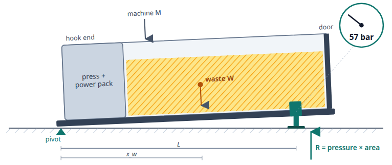

# The compactor weighs itself: hydraulic self-lift (H7)

Deliverable (1), illustrated weighing concept. Short version; the full working, sources and red team are in
`WEIGHING_CONCEPT.md` §19 (one-end lift) and §20 (two-end option). Every figure is a team estimate. **Nothing has
been built or tested.**

*Side view of a full COMBI during a reading (lift drawn exaggerated). Source: `figures/h7_side_view.svg`, rendered
from the demo.*

## Principle

A COMBI already has a hydraulic power pack for its ram. H7 adds one single-acting cylinder in the rear frame,
0.5–1 m forward of the door, plus one valve section and one pressure sensor. To take a reading, the cylinder lifts
the door end about 10 mm. The fronts of the runners stay on the ground and act as the pivot. At rest, cylinder
pressure × piston area is the door-end reaction R. Taking moments about the pivot:

**W = (R − R₀) · L / x_w**

R₀ is the reading of the empty unit, L is the distance from pivot to cylinder, and x_w is the distance from pivot to
the waste's centre of mass. Only the sensor carries load, and only for the ~30 s of a reading.

**Worked example** (3.75 t machine, 2.5 t of waste, 80 mm bore): tare 27 bar, full 57 bar. One bar is about 85 kg
of waste, so (57 − 27) × 85 kg ≈ 2.5 t. The heaviest case needs 113 bar, well under the ~200 bar on board.

## Placement, BOM and cost

- **Placement:** new COMBI units, cylinder between the runners in the rear frame, clear of door impacts.
  Hydraulics: steel pipe inside the frame to the power pack. Electronics: sensor input and valve driver on the
  SMART modem, in the press cabinet.
- **BOM:** 0–250 bar pressure transducer, rod position switch, oil temperature, motion sensor; 80 mm cylinder with
  spring return and a 300 mm ball-joint foot; a valve section with throttle, load-holding and relief valves.

| Cost per new unit (factory fit) | Team estimate |
|---|---|
| Capex (parts, fitting 3–6 h on the line, calibration, development) | €800–2,370; **planning figure €1,000** |
| Upkeep (seals, bellows, sensor) | €39–106 a year |
| For comparison: Europress platform scale under the whole unit | €7,860–22,160 |
| Retrofit on an existing unit (not recommended) | €1,994–6,168 |

## Calibration and accuracy

1. **Auto-zero** of the sensor before every lift, with the cylinder vented.
2. **Lift and lower at the same slow speed** (~15 s). Averaging the up and down plateaus cancels seal friction; the
   difference is logged as a seal-health signal.
3. **Weighbridge tickets calibrate each unit.** Every ticket the operator shares gives the true weight of one load
   and fits that unit's geometry and the waste's centre of mass.

| Accuracy per pick-up, 2.5 t of waste (1σ, error budget, untested) | low / mid / high |
|---|---|
| One lift, no tickets | 5.3 / 10.7 / 21.9 % |
| **One lift, after 10 tickets (target ≤ 5 %)** | **2.6 / 4.4 / 9.7 %** |
| Two-end lift (H7-2), after tickets | 1.7 / 3.2 / 8.4 % |

The biggest error is where the waste's centre of mass sits. Tickets remove the steady part; lifting both ends
(H7-2, §20) measures it directly, at €1,427–3,965 capex.

**We bill by the real scales.** The bill stays on the operator's certified weighbridge (EU Directive 2014/31/EU).
The self-lift gives the estimates for planning and forecasting, and every ticket cross-checks it.

## Error sources we know

| Source | Size (2.5 t, mid) | What handles it |
|---|---|---|
| Centre of mass of the waste | 3.0 % | fill model + tickets; two-end lift |
| Tare change (rain, ice, residue) | 2.0 % | tare at every return; heavy snow flagged from weather data |
| Pressure sensor repeatability | 1.8 % | nightly readings averaged |
| Seal friction left after averaging | 1.4 % | constant-speed up/down; worse in winter |
| Ground settling between tare and reading | 0.8 % | same placement; trend steps flagged |
| Sideways tipping on the narrow three-point support | not in budget | tilt sensors reject the reading |
| Runner fronts touching ice or debris | not in budget | lift-curve check; cold-and-wet rule |

## Safety

A self-lift is a new machine function. It needs a risk assessment and a CE file update (Directive 2006/42/EC;
Regulation (EU) 2023/1230 from 20 Jan 2027). The measures are:

- no reading while the hook is attached, the door is open or the ram moves;
- a load-holding valve, so a burst hose drops the unit at most 10 mm;
- a relief valve, so an over-heavy unit simply does not lift;
- spring return plus a position switch, so SMART allows pick-up only with the rod retracted.

## DUO

DUO containers have no hydraulics. For DUO, the hopper plate (H1) or weighing rails (H5) remain the options
(`WEIGHING_CONCEPT.md` §3, §20.5). The team's "duo mechanism" sheet turned out to be a two-end lift on a COMBI, not
a DUO design; it is the H7-2 option above.

## Validation plan (proposal)

| Stage | What | Pass |
|---|---|---|
| A. One unit, known loads | water IBCs at three positions, 20 cycles, warm and cold | within 2 % for known positions; repeatability < 1 bar |
| B. Real fills | every pick-up paired with a weighbridge ticket, 2–3 months | 1σ ≤ 5 % after 10 tickets |
| C. Ground and safety | gravel, hot asphalt, guide rails; interlock tests | no reading on stroke-out; no lift with an interlock open |
